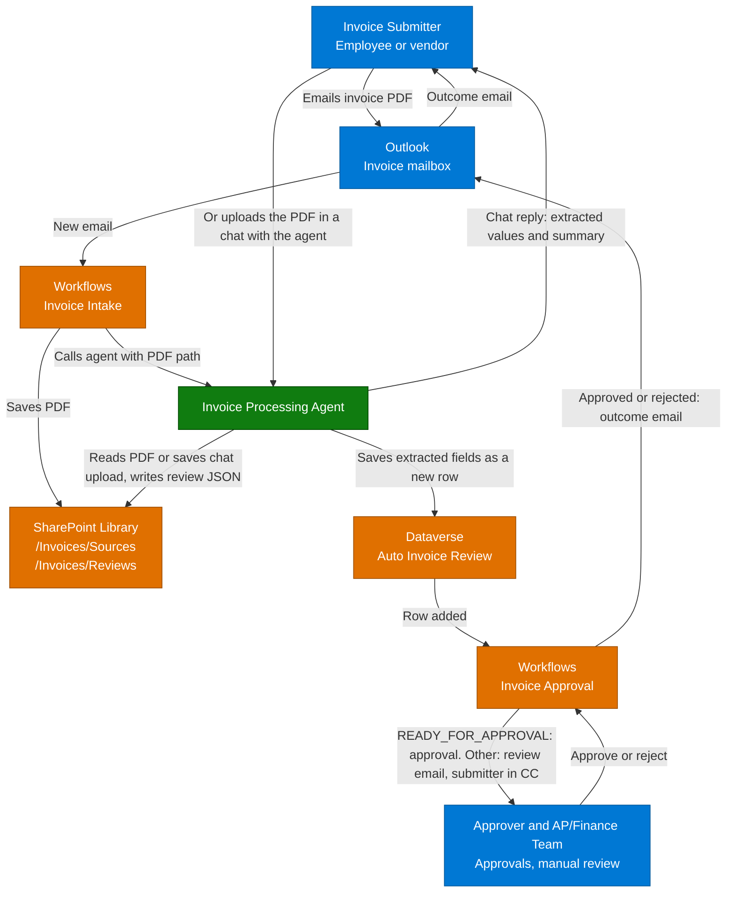

**1. Overview** > [2. Architecture](2.Architecture.md) > [3. Runbook](3.Runbook.md) > [4. Sample Prompts](4.Sample-prompts.md) > [5. Working Solution](5.Working-solution.md)

# Autonomous Invoice Orchestration Agent with GHCP Harness — Overview

## Scenario Overview

**Scenario Type**: Invoice Processing and Approval (Accounts Payable)  
**Harness**: GitHub Copilot 
**Agent Type**: Autonomous agent called by a Workflows email trigger, which a user can also open in the Copilot Studio chat to upload an invoice directly. A second workflow starts from the row that the agent saves 
**Primary Tools**: Microsoft Copilot Studio, Workflows, Outlook, SharePoint, Microsoft Dataverse, Approvals 
**Complexity**: Advanced

This scenario describes an **Invoice Processing Agent** that turns invoices arriving by email into structured, approvable records. When an email with a PDF invoice arrives in a designated mailbox, the **Invoice Intake** workflow saves the PDF to a SharePoint document library and calls the agent with the PDF's full path. The agent reads the invoice and saves the extracted fields, the submitter's Object ID and a decision to a Dataverse table, and saves the fields to a JSON review file in the same library. The new row starts a second workflow, **Invoice Approval**, which starts an approval when the decision is `READY_FOR_APPROVAL`. Otherwise it emails the Finance team for manual review, with the submitter in CC. After the approval, it tells the submitter whether the invoice was approved or rejected. A user can also chat with the agent directly and upload the PDF, which skips the mailbox and the intake workflow but adds the same row, so the approval starts in the same way.

The standard configuration has one agent and two workflows. The supplied artifacts are documentation, a data model, runtime skill definitions, four synthetic sample invoices and an unmanaged solution package, not a deployed agent. During setup, operators build the Dataverse table, the SharePoint folders, the agent and the two workflows, or import the [working solution](5.Working-solution.md), and keep the workflows turned off until the pilot is approved. See the [release gates](0.Resources/README.md#release-gates).

---

## Problem Statement

Accounts payable teams receive invoices as PDF attachments in shared mailboxes. Someone opens each email, saves the file, retypes vendor, invoice, amount and accounting details into a system, checks them and forwards the result for approval. Missing details, such as a purchase order number, are found late and chased by hand.

Without a clear process:

- Invoices wait in mailboxes, and retyped data contains mistakes.
- Original files, extracted data and the approval are not linked, so audits are slow.
- The same invoice can be processed twice.
- Incomplete invoices reach approvers, and Finance is not told which invoices need manual follow-up.
- Submitters do not hear whether their invoice was approved or rejected.
- An automated assistant that reads untrusted PDFs could be misled by text inside them, or act without limits.

---

## Solution Summary

The **Invoice Processing Agent** reads one saved PDF at a time and records what it finds. Its skill extracts and checks the fields, writes a review JSON file and saves a row in the **Auto Invoice Review** Dataverse table. Two workflows surround the agent, and the saved row is the only link between them. **Invoice Intake** receives the email, saves the PDF to `/Invoices/Sources`, looks up the sender's Object ID and calls the agent, and it ends there. **Invoice Approval** starts when the agent adds the row, checks the row's decision, and then starts an approval or emails the Finance team for manual review. After the approval, it emails the submitter the outcome.

The approval workflow, not the agent, makes the decision check, starts the approval and sends the emails. The agent has no email or approval tool and returns nothing that a workflow reads. Every PDF is treated as untrusted data, and the agent writes only to the Dataverse table, to `/Invoices/Reviews` and, for a PDF uploaded in the chat, to `/Invoices/Sources`. There is no human approval of the intake itself. A person approves each invoice that is ready for approval.

### Key Capabilities

| Capability | Description |
|---|---|
| Invoice capture | The intake workflow reads its settings from environment variables, saves each PDF attachment to `/Invoices/Sources`, looks up the sender's Object ID in the directory and passes the full path, the email subject and the Object ID to the agent |
| Direct upload in chat | A user can upload a PDF in a chat with the agent in Copilot Studio instead of emailing it. The agent saves the PDF to `/Invoices/Sources`, reads the chatting user's Object ID, processes the invoice in the same way and replies with a table of the extracted values and a short summary |
| Invoice extraction and record | `invoice-extraction-review` reads the invoice from the saved PDF or a SharePoint link, creates the Source Link, extracts 11 fields and works out Issues Found, a Summary and a Decision |
| Review JSON file and row | `invoice-extraction-review` writes the extracted fields and the email details to a JSON file in `/Invoices/Reviews`, creates its sharing link and then saves one row in the **Auto Invoice Review** table with both links and the submitter's Object ID. The new row starts the approval workflow |
| Decision check | The approval workflow checks the row's Decision. Only `READY_FOR_APPROVAL` continues to the approval |
| Approval | When the Decision is `READY_FOR_APPROVAL`, the approval workflow starts an approval with the vendor, amounts, summary and links |
| Manual review email | Any other Decision sends an email to the Finance team, with the submitter in CC, with the invoice number, vendor, issues, summary and links |
| Outcome email | After the approval, the approval workflow emails the submitter that the invoice was approved or rejected, with links to the source PDF and the review package |

## How It Works

A submitter emails an invoice PDF to the designated mailbox. The intake workflow saves each PDF, looks up the sender's Object ID and calls the agent, which reads the saved file and writes the review JSON and the Dataverse row. A submitter can also skip the mailbox and upload the PDF in a chat with the agent in Copilot Studio. The agent then saves the PDF to `/Invoices/Sources` itself, reads the chatting user's own Object ID, writes the same review JSON and row, and replies in the chat with a table of the extracted values and a short summary. In both paths the new row starts the approval workflow. If the Decision is `READY_FOR_APPROVAL`, it starts an approval for the submitter's manager (or for the Finance team when the submitter has no manager) and, when the approver answers, emails the submitter that the invoice was approved or rejected. Any other Decision means a value is missing: the stored row is marked `NEEDS_REVIEW` and the approval workflow emails the Finance team with the submitter in CC, and Finance follows up. When the agent fails before it saves a row, the approval workflow never starts and nobody is emailed.

This is the documented flow, not a deployed integration. Identity, delivery and operational limitations are in [Architecture](2.Architecture.md) and the [capability matrix](0.Resources/Capability-matrix.md).

---

## Business Outcomes

| Outcome | Description |
|---|---|
| ⏱️ Faster invoice intake | Measure time from email arrival to a stored, reviewed record against a pre-pilot baseline |
| 🎯 Consistent data capture | Measure extraction accuracy for each field against the PDF, with separate rates for missing and wrong values |
| ✅ Complete invoices at approval | Track the share of approvals that start with every field present, and the share sent to manual review |
| 📬 Clear feedback | Measure how long Finance takes to resolve a manual-review email, and how often submitters get an approved or rejected email without asking |
| 🔍 Traceable records | Check that the original PDF, the JSON review file, the Dataverse row and the approval can be linked to each other |
| 🔁 Less re-keying | Track how many invoices reach an approval without anyone typing the fields again, and how many extra rows need cleaning up |
| 💳 Controlled adoption | Track Copilot Credits per processed invoice, failed runs and manual follow-up before wider use |

These are target outcomes and measures, not observed improvements or a guarantee of error-free extraction.

---

## Target Users

| Persona | Role in This Scenario |
|---|---|
| **Invoice Submitters (employees and vendors)** | Email invoices to the mailbox, or upload them directly in a chat with the agent, and receive an email when the invoice is approved or rejected |
| **Approvers (the submitter's manager, or AP/Finance)** | Review the vendor, amounts, summary and the source PDF in the approval, then approve or reject. Finance approves when the submitter has no manager |
| **AP/Finance Team** | Owns the mailbox, receives the manual review emails and follows up with submitters on invoices with missing information |
| **Finance Operations / Reporting** | Uses the Dataverse table and the review files for reporting and audit |
| **System Admins / Power Platform Engineers** | Build and test the table, agent, workflows and connections, and monitor failed runs |
| **Solution Owner / Business Stakeholders** | Approve the pilot scope, retention, release evidence, cost and rollback |

---

## In Scope / Out of Scope

### ✅ In Scope

- A first workflow, **Invoice Intake**, that starts when a new email arrives in the designated mailbox and keeps only PDF attachments.
- Reading the site, library and source folder from environment variables, and failing the run with a clear message when one has no value.
- Saving each PDF to the SharePoint document library folder `/Invoices/Sources`.
- Calling the Invoice Processing Agent through the Workflows Agent node with the full path of the PDF, the email subject and the sender's Object ID.
- Looking up the email sender's Object ID in the directory with the Office 365 Users connector, and continuing with an empty value when the sender is not found.
- Direct upload: a user chats with the Invoice Processing Agent in Copilot Studio and uploads the PDF. The agent saves it to `/Invoices/Sources`, reads the chatting user's Object ID with the Office 365 Users connector, processes the invoice in the same way as an emailed one and replies in the chat with a table of the extracted values and a short summary. The row it saves starts the same approval workflow.
- Extracting invoice fields from the PDF and saving them, with the submitter's Object ID, to the **Auto Invoice Review** Dataverse table, with Decision `NEEDS_REVIEW` or `READY_FOR_APPROVAL`.
- Saving the extracted fields as a JSON file in `/Invoices/Reviews`.
- A second workflow, **Invoice Approval**, that starts when a row is added to the table, looks up the submitter's email address and manager from the Submitted By value, and reads the Finance address from an environment variable.
- A deterministic decision check in the approval workflow. An approval starts only when the Decision is `READY_FOR_APPROVAL`, which the skill sets only when all 11 invoice fields were found.
- An email to the Finance team for manual review when the Decision is anything else, with the submitter in CC.
- An approval for the submitter's manager, or for the Finance team when the submitter has no manager.
- An email to the submitter after the approval that says whether the invoice was approved or rejected.
- Preview and Evaluate acceptance cases, controlled publishing and rollback.

### ❌ Out of Scope

- Payment, posting to an accounting or ERP system, vendor onboarding and vendor master data changes.
- A separate message to the submitter about what is missing from an invoice (the submitter is only copied on the manual review email to Finance, which does the follow-up), and reminders or escalation of approvals.
- Submitters who are not in the directory. An external sender gets no Object ID, so the row has an empty Submitted By, the approval goes to Finance and no outcome email is sent.
- Invoices that are not PDFs, such as images, Word files or links to portals.
- Publishing the chat with the agent to Teams, Microsoft 365 Copilot or other production channels. Direct upload is limited to the chat in Copilot Studio.
- Duplicate detection, so a resubmitted invoice creates another row, another review file and another approval.
- Checks that the amounts add up or that the bill-to is an approved legal entity, and automatic correction of wrong values that are present.
- Bank account details, sensitive personal data and real invoices before the pilot is approved.
- Guaranteed accuracy on scanned or handwritten invoices.
- A production-ready tenant deployment.

When an environment variable has no value, the workflow that reads it ends the run as failed with a message that names it, so that the run history shows it. The approval workflow does not check the source and review links. When the agent fails before it saves a row, the approval workflow never starts and nobody is emailed. Every row added to the table under the account that owns the approval workflow starts an approval, including rows from tests and rows that this account adds by hand. The agent does not invent a value, a link or a successful write.

Runtime definitions: [Skill index](0.Resources/Skills/README.md).

---

## Related Resources

| Resource | Link |
|---|---|
| Architecture | [Architecture](2.Architecture.md) |
| Step-by-Step Runbook | [Runbook](3.Runbook.md) |
| Sample Prompts | [Prompts](4.Sample-prompts.md) |
| Working Solution | [Working solution](5.Working-solution.md) |
| Capability and Integration Contracts | [Capability matrix](0.Resources/Capability-matrix.md) |
