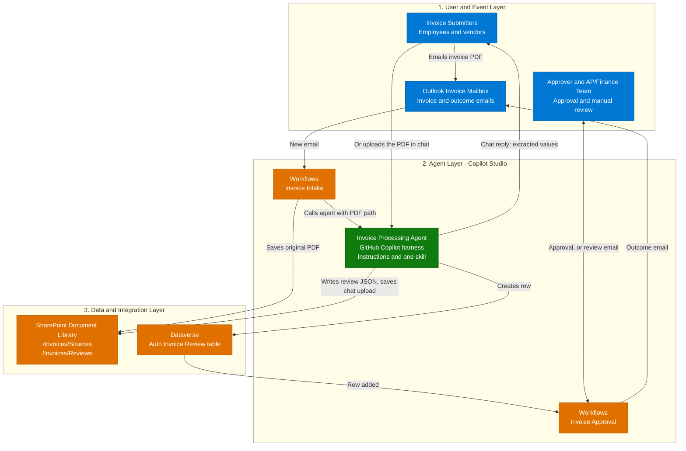
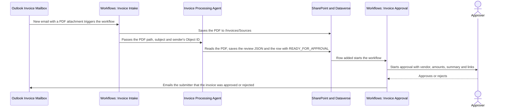
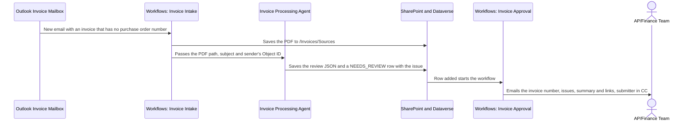
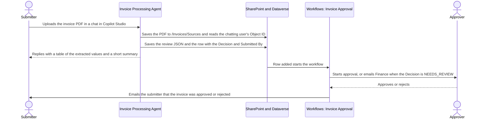

[1. Overview](1.Overview.md) > **2. Architecture** > [3. Runbook](3.Runbook.md) > [4. Sample Prompts](4.Sample-prompts.md) > [5. Working Solution](5.Working-solution.md)

# Autonomous Invoice Orchestration Agent — Architecture

## 1. Logical Architecture

The three layers are the submitters, mailbox, approver and Finance team at the edge, the Copilot Studio layer with the two workflows and the GitHub Copilot agent, and the document library and Dataverse table that they use. The agent is not published to an end-user channel. It is called by the intake workflow for each emailed invoice, and a user can also chat with it in Copilot Studio and upload an invoice directly.

One configuration includes the workflows **Invoice Intake** and **Invoice Approval** and the one skill. Operators build the Dataverse table, the SharePoint folders, the agent and the two workflows in the tenant. The intake workflow owns the email trigger, the saved original, the sender lookup and the agent call. The agent owns reading the PDF and writing the review JSON file and the Dataverse row. For a PDF uploaded in the chat, the agent also saves the original and reads the chatting user's Object ID itself. The approval workflow starts from that row and owns the decision check, the approval and the emails to Finance and to the submitter. No custom backend is required or supplied.

### How It Works

The diagram summarizes the layers. The decision branches, the approval and the outcome emails are in the Data Flow diagrams below. The email path is **submitter → Outlook invoice mailbox → Invoice Intake workflow → Invoice Processing Agent → Dataverse row → Invoice Approval workflow → approval, Finance email and outcome email**. The direct path is **submitter → chat with the Invoice Processing Agent → Dataverse row → Invoice Approval workflow**, with a chat reply to the submitter. The intake workflow owns the trigger and the agent call and ends there. The agent returns nothing that a workflow reads. It does not send email, start an approval or invoke a workflow. The row it adds, on either path, is what starts the approval workflow, which owns the decision check and every outcome (see the [row contract](0.Resources/Capability-matrix.md#row-contract)). The agent reaches SharePoint and Dataverse through its own tools, and the workflows reach them through their own connectors. All of them write only to the folders and the table named in the [capability matrix](0.Resources/Capability-matrix.md#agent-tool-contracts).

---

## 2. Key Components

| Component | Technology | Role |
|---|---|---|
| Event entry | Office 365 Outlook **When a new email arrives** in Copilot Studio Workflows | Starts the intake workflow for each email with attachments in the invoice mailbox. The mailbox and the identity are configured during setup |
| Intake workflow | Copilot Studio Workflows, **Invoice Intake** | Created by Copilot from the prompt in [Step 3-3 of the Runbook](3.Runbook.md#step-3-3-build-the-intake-workflow-invoice-intake). Reads the environment variables, saves each PDF, looks up the sender's Object ID with Office 365 Users and calls the agent. It ends at the Agent node and reads nothing back |
| Approval workflow | Copilot Studio Workflows, **Invoice Approval** | Created by Copilot from the prompt in [Step 3-4 of the Runbook](3.Runbook.md#step-3-4-build-the-approval-workflow-invoice-approval). Starts when a row is added to the table, reads the row with **Get a row by ID**, looks up the submitter's email address from the row's Submitted By, checks the row's Decision, then starts the approval or emails Finance, and emails the submitter the approval outcome |
| Settings | Power Platform environment variables | The intake workflow reads `SharePointSiteURL`, `SharePointDocumentLibrary` and `SourceFolderPath` by display name. The approval workflow reads `FinanceEmailAddress`. The agent's skill reads `SharePointSiteURL`, `SharePointDocumentLibrary`, `SourceFolderPath` and `ReviewsFolderPath` |
| Agent call | Workflows Agent node `InvoiceProcessingAgent`, **An existing agent** | Calls the published Invoice Processing Agent with the PDF path, the email subject and the sender's Object ID. The node keeps its default text output and nothing reads it |
| Agent runtime | Copilot Studio GitHub Copilot harness | Reads and reasons over the invoice and follows the skill procedures. It is not Copilot CLI or a Copilot SDK host |
| Skills | One standalone definition | `invoice-extraction-review` (extraction, checks, the review JSON, the sharing links and the Dataverse row). It is the one capability the agent runs |
| Agent tools | SharePoint MCP, Dataverse MCP, the `CreateSharingLink` tool and the Office 365 Users `GetMyProfile` tool in the agent | Read a file from its link, create a view-only sharing link, create a file in `/Invoices/Reviews` (and in `/Invoices/Sources` for a PDF uploaded in the chat), read the environment variables, read the chatting user's Object ID and create a row on one table |
| Document library | SharePoint document library | Holds the original PDFs in `/Invoices/Sources` and the review JSON files in `/Invoices/Reviews` |
| Data store | Dataverse table **Auto Invoice Review** | One row per run with the 18 columns and the native row ID defined in the [data model](0.Resources/Capability-matrix.md#dataverse-data-model). The added row starts the approval workflow when the same account owns the workflow and made the agent's Dataverse connection |
| Approval | Office 365 Users **Get manager (V2)** and Approvals connector **Start and wait for an approval** in the approval workflow | Looks up the manager of the row's Submitted By, sends the vendor, amounts, summary and links to that manager, and records the outcome. When the submitter has no manager, the approval goes to the `FinanceEmailAddress` value |
| Emails | Office 365 Outlook **Send an email** in the approval workflow | Sends the manual review email to the `FinanceEmailAddress` value, with the submitter in CC, and, after the approval, the approved or rejected email to the submitter, once per row |
| Monitoring | Run histories of both workflows, agent run history, approval records and the mailbox | Operators inspect failures and uncertain outcomes. No custom queue or status API exists |

### Capability Design

| Capability | Component | Behavior and controls |
|---|---|---|
| Invoice capture | Intake workflow trigger, environment variables and SharePoint **Create file** | Keeps PDF attachments only, saves each under its attachment name in `/Invoices/Sources`, looks up the sender's Object ID, and passes the full path, the email subject and the Object ID to the agent. A missing environment variable fails the run before anything is saved. A sender who is not in the directory gives an empty Object ID and the run continues. A message without a PDF ends the run with no email |
| Direct upload in chat | Agent and `invoice-extraction-review` | A user uploads a PDF in a chat with the agent in Copilot Studio. The skill saves it to `/Invoices/Sources` under the uploaded name, reads the chatting user's Object ID with `GetMyProfile` and continues as for an emailed invoice. The agent replies in the chat with a table of the extracted values and a short summary. No intake workflow or mailbox is involved. The row it saves starts the approval workflow, which sends the outcome email to the chatting user |
| Invoice extraction and record | `invoice-extraction-review` | Reads the invoice from a chat attachment or a SharePoint link, creates a sharing link for the Source Link, extracts 11 fields and leaves a missing field empty. Derives Issues Found, a Summary and a Decision (`READY_FOR_APPROVAL` only when all 11 are found) |
| Review JSON file and row | `invoice-extraction-review` | Reads the site, library and Reviews folder from environment variables and stops, naming the variable, when one has no value. Writes a 17-key JSON file to the Reviews folder, creates its sharing link and then creates one row in the Auto Invoice Review table with the Source Link, the Review Link and the Submitted By Object ID. The row is the last write, and it starts the approval workflow |
| Decision check | Approval workflow condition | Applies the [decision rule](0.Resources/Capability-matrix.md#decision-rule) to the row's Decision. Only `READY_FOR_APPROVAL` continues to the approval. The skill sets it only when all 11 invoice fields were found. The workflow, not the agent, decides who is notified |
| Approval | Approval workflow Approvals action | Starts only for `READY_FOR_APPROVAL`. It is assigned to the submitter's manager, or to Finance when the submitter has no manager. The approver sees the vendor, total amount due, dates, summary and links to the source PDF and the review package |
| Manual review email | Approval workflow Outlook send action | Emails the Finance team, with the submitter in CC, the invoice number, vendor, decision, issues, summary and the two links. Finance follows up |
| Outcome email | Approval workflow if/else and Outlook send action | After the approval, a three-branch check (Approved, Rejected, Other) emails the submitter that the invoice was approved or rejected, with the approver's comment and the links. The Other branch sends nothing |
| Failure follow-up | Workflow owner | A missing environment variable or a failed step ends that workflow run as failed. When the agent fails before it saves a row, the approval workflow never starts and nobody is emailed. The owner inspects both run histories and handles the invoice manually. The approval workflow does not check the source or review link |

The design uses one agent and two workflows. No connected agent, ERP feed, payment system or general mailbox search is needed.

### Capabilities and Workflow Configuration

The [matrix](0.Resources/Capability-matrix.md) records the agent's tools, the five intake steps and six approval steps, the row contract, the decision rule and the data model. The agent's tools are configured in **Build > Tools**. Outlook, SharePoint save and Approvals operations belong to the workflows, not to the agent.

The [Workflows Agent-node guidance](https://learn.microsoft.com/en-us/microsoft-copilot-studio/workflows-experience/agent-node-workflow) documents selecting an existing published agent. The [Dataverse trigger guidance](https://learn.microsoft.com/en-us/power-automate/dataverse/create-update-delete-trigger) documents the row-added trigger, its scope and the Callback Registration rights of its creator. Before the workflows are turned on, operators verify the selected agent and version, the effective identity of the agent's tool connections and that it is the owner of the approval workflow, that the harness reads the PDF content returned by the SharePoint tool, and that the Dataverse trigger fires for a row that the agent adds and returns the Decision in the form that the check expects. [Resources](0.Resources/README.md#release-gates) lists these checks as release gates.

---

## 3. Data Flow

### Scenario A — Ready for Approval and Outcome Email

This is the routine path. The intake workflow ends when it has saved the PDF, looked up the sender's Object ID and called the agent. The approval workflow starts from the row that the agent adds, looks up the submitter's email address from the row's Submitted By, and starts the approval only when the Decision is `READY_FOR_APPROVAL`. After the approver answers, it emails the submitter the outcome. The approver is the submitter's manager, or the Finance team when the submitter has no manager. An outcome other than approve or reject sends no email. The workflows do not pay the invoice.

### Scenario B — Missing Information and Manual Review

This diagram shows the missing-information path. No approval starts. The submitter is in CC on the Finance email. The row stays in Dataverse with Decision `NEEDS_REVIEW`, and Finance follows up with the submitter. A corrected invoice is processed as a new email. Nothing looks for the earlier row, so the corrected invoice creates another row, another review file and another approval or review email.

### Scenario C — Direct Upload in Chat

This diagram shows the direct path, which skips the mailbox and the intake workflow. The submitter chats with the agent in Copilot Studio and uploads the PDF. The skill saves the PDF to `/Invoices/Sources` under the uploaded name, reads the chatting user's own Object ID with `GetMyProfile` and writes the same review JSON and row as for an emailed invoice. The agent replies in the chat, and the row starts the same approval workflow, so the approval, the Finance email and the outcome email are identical. The Object ID comes from the signed-in user, not from a From address. The row must be owned by the account that owns the approval workflow, which is a release gate. The chat in Copilot Studio is the only direct channel, and Teams and Microsoft 365 Copilot are not used.

Other outcomes are summarized here. An environment variable with no value ends that workflow's run as failed before it saves or sends anything. A sender who is not in the directory, or an empty Submitted By, does not stop either workflow: the approval goes to Finance, the manual review email has no CC and the outcome email has no recipient. A failed agent step ends the intake run as failed or without a row, which is a release gate. It leaves the saved PDF and any files already written, and the approval workflow never starts, so nobody is emailed. An email with no PDF attachment ends the intake run with no saved file and no email. See the [outcome handling](0.Resources/Capability-matrix.md#outcome-handling), the [limitations](0.Resources/Capability-matrix.md#limitations-and-operational-ownership) and the [Runbook](3.Runbook.md).

---

## 4. Security & Governance Considerations

| Area | Consideration |
|---|---|
| Identity | The agent's SharePoint, Dataverse and Office 365 Users connections use a dedicated service account, not a maker's personal account and not the email sender. Whether workflow-invoked runs use that connection, and whether `GetMyProfile` then returns the chatting user, are release gates. The intake workflow's Outlook, SharePoint and Office 365 Users connections and the approval workflow's Dataverse, Outlook, Office 365 Users and Approvals connections are owned and reviewed separately |
| Access control | Table scope and connection permissions limit what the agent can write. The agent's account has read rights on the Invoices library, contribute rights on `/Invoices/Reviews` and `/Invoices/Sources` only and create, read and write rights on one table. These limits do not rely on instructions alone, because the skill does not check paths |
| Untrusted input | Email text and PDF content are data. The agent receives only the PDF path that the intake workflow built, plus the email subject and the sender's Object ID as data. It never receives the email body. Text in a PDF that tries to give instructions is ignored and recorded as an issue. Values extracted from a PDF are stored in the row and appear in the approval and in the emails, so Finance and the approver compare them with the source PDF |
| Authorization and writes | The agent has no email, approval or workflow tool. The approval workflow decides the approval and the emails from the row's Decision. Anyone who can add a row to the table starts that workflow, so limit write access to the table. A person approves each invoice that is ready for approval, and no payment is made |
| Reliability | The attachment keeps its own file name, so a repeated attachment name can collide in the library. There is no duplicate detection, so a repeated invoice or a trigger that fires twice for one email can create a second row, a second review file and a second approval. A partial failure ends the run as failed and leaves what was already written. A run of the intake workflow that succeeds does not prove that a row exists |
| Data handling | Invoices hold vendor, amount and tax business data. Limit access to the mailbox, the library, the table and the run histories, and set retention for originals, reviews and rows. Keep memory and unrelated personal-context retrieval off |
| Deployment | Use a dedicated mailbox and an optional sender allowlist. Verify the tenant, model, credits and Approvals availability, then pilot with synthetic invoices before real ones |
| Disablement | Turn off the intake workflow first, so no new rows appear, then the approval workflow. Then remove the agent's tool exposure or unpublish the agent. Removing a skill does not revoke tool permissions. Keep written files and rows |

### Identity, Permissions and Data Handling

**Mailbox identity:** the Outlook trigger of the intake workflow and the send actions of the approval workflow use the connection of the account that owns the invoice mailbox. Verify the monitored folder and the sending rights. Receiving mail does not automatically grant the right to send, and a shared mailbox needs its own address set in the send action.

**Agent identity:** the SharePoint, Dataverse and Office 365 Users tools run under the connection configured for the agent. Grant that account only the rights listed above. A write by the agent is therefore limited by the account, not by a prompt.

**Workflow identity:** the intake workflow saves the original PDF and calls the agent. The approval workflow starts the approval and sends the emails, under its own connections, and its creator needs rights on the Callback Registration table for the Dataverse trigger. The approval and the emails use values extracted from an untrusted PDF, so the approver is the submitter's manager from the directory or the Finance address from an environment variable, and is never taken from the PDF, and the approver compares the values with the source PDF.

**Sender identity:** a sender's display name can be forged. The intake workflow turns the From address into an Object ID, so a forged From address maps to the real person's Object ID. The approved or rejected email goes to the submitter's address that the approval workflow looks up from that Object ID, and the manager lookup uses the same Object ID, so a forged sender can route the approval to another person's manager. A sender who is not in the directory gives an empty Object ID, and the approval then goes to Finance. The approver gets the link to the source PDF. A sender allowlist and the mailbox's own anti-spoofing controls are the first line of defense.

### Reliability and Deployment Boundaries

| Concern | Current limitation / operator action |
|---|---|
| Duplicate triggers | The attachment name is reused, so a second save may fail, overwrite or get a new name, which is a release gate. Nothing prevents a second row, and every added row that the workflow's owner owns starts an approval workflow run. Inspect the run histories if an email shows two runs and delete the extra row |
| Loops and bounces | Add a trigger filter that excludes mail sent by the mailbox itself. The approval workflow sends emails to Finance and to the submitter only for a row that the agent added. Review auto-responders, which can start a mail loop |
| Rate limits and concurrency | Check the concurrency setting of the attachment loop. Inspect connector throttling and retries. No custom rate limiter or queue exists |
| Unreadable invoices | The agent saves a `NEEDS_REVIEW` row with issues, and the approval workflow emails Finance. A failed agent step fails the intake run or leaves no row, which is a release gate. When there is no row, nobody is emailed. Missing values are never filled in |
| Wrong values that are present | The decision check finds only missing values. The approver compares the extracted fields with the PDF |
| Approval outcome | The result is in the approval record and the run history, and the submitter gets an approved or rejected email. It is not written back to Dataverse |
| Maintenance / rollback | Disable the intake workflow, then the approval workflow after you inspect runs in flight, then remove tool exposure or unpublish the agent |
| Cost and capacity | Workflow runs, agent runs and the approval wait use Copilot Credits and platform limits. Verify environment, model and credits |

The runbook leaves both workflows off until the agent, the non-sending checks and the pilot approval are ready. This documentation claims neither tenant execution nor production readiness.

---

Official guidance and remaining owner checks: [Resources](0.Resources/README.md#official-source-verification).

## Related Resources

| Resource | Link |
| --- | --- |
| Scenario Overview | [Overview](1.Overview.md) |
| Step-by-Step Runbook | [Runbook](3.Runbook.md) |
| Sample Prompts | [Prompts](4.Sample-prompts.md) |
| Working Solution | [Working solution](5.Working-solution.md) |
| Capability and Integration Contracts | [Capability matrix](0.Resources/Capability-matrix.md) |
