[1. Overview](1.Overview.md) > [2. Architecture](2.Architecture.md) > **3. Runbook** > [4. Sample Prompts](4.Sample-prompts.md) > [5. Working Solution](5.Working-solution.md)

# Step-by-Step Guide — Autonomous Invoice Orchestration Agent

## Overview

Accounts payable teams receive invoices as PDF attachments and re-key them by hand. The **Invoice Processing Agent** uses the **GitHub Copilot harness in Microsoft Copilot Studio** to read each invoice, store the extracted fields and send complete invoices for approval. It serves invoice submitters (employees and vendors), approvers, the AP/Finance team, finance operations and reporting, system admins and the solution owners. 

The agent:

- Reads one saved invoice PDF per run from the SharePoint document library.
- Saves the extracted fields, the Object ID of the person who submitted the invoice and a Decision of `NEEDS_REVIEW` or `READY_FOR_APPROVAL` as one row in the **Auto Invoice Review** Dataverse table.
- Saves the extracted fields as a JSON file in `/Invoices/Reviews`.

Two workflows surround the agent, and the Dataverse row is the only link between them. Copilot builds both from ready-made prompts. **Invoice Intake** ([Step 3-3](#step-3-3-build-the-intake-workflow-invoice-intake)) starts when an email arrives, reads its settings from environment variables, saves each PDF attachment to `/Invoices/Sources`, looks up the sender's Object ID and calls the agent with the saved PDF path, the email subject and the Object ID. It ends there. **Invoice Approval** ([Step 3-4](#step-3-4-build-the-approval-workflow-invoice-approval)) starts when the agent adds a row to the table and checks its Decision. `READY_FOR_APPROVAL` starts an approval and the submitter gets an approved or rejected email. Any other Decision sends a manual review email to the Finance team, with the submitter in CC.

Use one standard configuration with the one [runtime skill](0.Resources/Skills/README.md). The flow is **email → Invoice Intake workflow → existing published agent → Dataverse row → Invoice Approval workflow → approval or Finance email → email to the submitter**. No email, approval or workflow tool is exposed to the agent, and the agent returns nothing that a workflow reads. The [matrix](0.Resources/Capability-matrix.md) holds the tool and workflow contracts, the row contract and the limits. These documents and skills are not a deployed solution, and the walkthrough has no tenant evidence until you record it. To start from a ready-made unmanaged solution instead of building the components, see [5. Working Solution](5.Working-solution.md).

---

## Prerequisites

Before starting, confirm the following are in place:
 
| Requirement | Details | Where to Configure |
| --- | --- | --- |
| Copilot Studio with the GitHub Copilot harness | Maker roles, an approved generally available model, region, data policies and a credit budget for building, testing, evaluating and running | Copilot Studio and Power Platform Admin Center |
| Power Platform environment with Dataverse | An approved non-default development environment, plus the Test and Production environments for later promotion | Power Platform Admin Center |
| Connectors allowed together | A data policy that allows SharePoint, Office 365 Outlook, Office 365 Users and the agent call together for the intake workflow, and Microsoft Dataverse, Office 365 Outlook, Office 365 Users and Approvals together for the approval workflow. The agent uses SharePoint, Microsoft Dataverse and Office 365 Users | Power Platform Admin Center |
| Invoice mailbox | A dedicated mailbox that receives invoices, the mailbox type and the sending rights for the Finance and submitter emails. An optional sender allowlist `[FILL]` | Exchange / Microsoft 365 admin center |
| SharePoint site and library | A site and library with the folders `/Invoices/Sources` and `/Invoices/Reviews`, kept to short names | SharePoint |
| Service account | A dedicated account for the agent's SharePoint, Dataverse and Office 365 Users connections, with only the rights in the [matrix](0.Resources/Capability-matrix.md#agent-tool-contracts) | Microsoft Entra ID and Power Platform |
| Approvers and Finance contact | Managers of the employees who submit invoices, who can use Approvals and are set in the directory, and the Finance team address `[FILL]` that receives manual review emails and approvals for submitters who have no manager. The owner of the approval workflow's Dataverse connection needs rights on the **Callback Registration** table | Finance owner and Power Platform admin |
| Business values | The files-per-email cap and retention rules `[FILL]` | AP/Finance and records owners |
| Test evidence | Test accounts, the [sample invoices](0.Resources/Sample-invoices/README.md) and a restricted delivery record | Test and privacy owners |

Assign the AP/Finance, mailbox, SharePoint, Dataverse, identity, integration, privacy, test, release and cost owners. Record the actual configuration in an access-controlled delivery record. Never put passwords, tokens, connection secrets or real invoices in Git.

---

## Phase 0: Environment Setup

### Step 0-1. Create Power Platform Developer Environment

If you already have a Power Platform Developer environment that meets the prerequisites above, skip to [Step 0-2. Configure Copilot Credits for the environment](#step-0-2-configure-copilot-credits-for-the-environment). Otherwise, follow these steps to create one.

1. Go to **Power Platform Admin Center** → https://admin.powerplatform.microsoft.com
2. Click **Environments** → **+ New**

> 

3. Fill in the following values and click **Next**

   | Required Field | Value |
   |---|---|
   | Name | `Copilot` (or any preferred name) |
   | Managed Environment | Follow the tenant's approved governance policy |
   | Region | Select the approved region where GHCP authoring is available |
   | Type | **Developer** |

4. Fill in the following values

   | Required Field | Value |
   |---|---|
   | Language | `English (United States)`(Suggested) |
   | Currency | `USD($)` (or any preferred currency)|

> 

5. Click **Save**, then verify Dataverse, maker access, data policies and GHCP availability. Do not change model-provider or cross-region permissions without tenant approval.

### Step 0-2. Configure Copilot Credits for the environment

If you already have Copilot Credits allocated to your Power Platform environment, skip to [Phase 1](#phase-1-sharepoint-setup). Otherwise, follow these steps to configure billing or allocate credits.

1. In **Power Platform Admin Center**, select **Licensing** from the left menu.

> 

2. If you have an Azure subscription linked to your tenant, you can configure a **pay-as-you-go billing plan**. Create an Azure resource group first, then create a new billing plan under **Billing Plans**. Select your Azure subscription and resource group and at least the **Copilot Studio** meter. Create the billing plan in the same region as the environments where you want to use pay-as-you-go billing. Add your development environment to the plan's **Target environments** and save the plan.

> 

3. If your tenant has a **Copilot Credit pack**, allocating credits from that pack is another option for your development environment. Under **Licensing**, select **Copilot Studio** → **Manage Copilot Credits**, select your environment and allocate credits. Set an environment-level allocation and review the **Capacity overages** settings. For development, consider disabling **Draw from the available capacity in my tenant** to avoid consuming unallocated tenant capacity. If **Bill to my pay-as-you-go billing plan** remains enabled, usage beyond the allocation can still incur Azure charges.

> , 


### Release gates

Complete the owner-assigned [release gates](0.Resources/README.md#release-gates) G1 to G9 as part of this walkthrough. They are stages of the same standard configuration, not optional capabilities. Start with G1 and G2, because the other work depends on them: whether the harness reads the PDF content that the SharePoint tool returns, and whether the Agent node can call the published agent.

---

## Phase 1: SharePoint Setup

### Step 1-1. Create the SharePoint Folders and Permissions

1. Create SharePoint site or use existing site
   
2. In the SharePoint site, create or choose the document library and add the folders `/Invoices/Sources` and `/Invoices/Reviews`.

   

3. Verify that account used to run the workflow and agent actions have **Edit** permissions in the site
   
4. Keep the site, library and folder names short. Source Link and Review Link are capped at 200 characters.

---

## Phase 2: Create Dataverse Solution, Table and Environment Variables

### Step 2-1. Create Solution

Create the **Autonomous Invoice Orchestration** solution in the Power Apps portal

Sign in to [Power Apps](https://make.preview.powerapps.com), select the development environment, then select **Solutions** in the left navigation. If **Solutions** is not shown, select **More** first.

1. On the command bar, select **New solution**.
   > 
   
2. Create solution like below choosing your publisher or create one if not exists:
   > 

3. Click **Create**

### Step 2-2. Create Table

We will use **Copilot** to create the Auto Invoice Review table. Verify that Copilot is enabled in your environment [Enable Copilot](https://learn.microsoft.com/en-us/power-platform/admin/settings-features#copilot-preview). 

If you can't enable and use Copilot then create table manually using [data model](0.Resources/Capability-matrix.md#dataverse-data-model)
 

1. In solution select **+ New > Table > Tables**

   

2.  Select **Start with Copilot** 

      

3. In the **Table options** menu of the prompt box, set the number of tables to **One table** and paste the prompt below and click **Generate**
   
   

   ```text
   Create "Auto Invoice Review" table with these 18 columns. Make sure that table really contains all these columns

   | Display Name | Data Type | Options |
   | --- | --- | --- |
   | Invoice Number | Text | 100 |
   | Accounting GL Code | Text | 100 |
   | Billed to Legal Entity | Boolean | — |
   | Currency | Text | 100 |
   | Decision | Choice | NEEDS_REVIEW, READY_FOR_APPROVAL |
   | Due Date | Date Only | — |
   | Invoice Date | Date Only | — |
   | Issues Found | Multiline Text | — |
   | Purchase Order Number | Text | 100 |
   | Review Link | URL | 200 |
   | Source Link | URL | 200 |
   | Submitted By | Text | 100 |
   | Subtotal | Decimal | — |
   | Summary | Multiline Text | 2000 |
   | Tax | Decimal | — |
   | Total Amount Due | Decimal | — |
   | Vendor ID | Text | 100 |
   | Vendor Name | Text | 100 |
   ```

   The prompt asks for 18 columns. It does not list a GUID column, because Dataverse creates the row ID itself as the table's native primary key. The scenario calls that value the **Auto Invoice Review ID**.

4. Copilot opens the **Create new tables** workspace.
   
5. In the workspace, select **Auto Invoice Review** table and expand it to show all columns. Compare the list with the red box in the screenshot below: one table, 18 columns, and no separate **Name** column. The screenshot was taken before **Submitted By** was added to the prompt, so it shows 17 columns and your list has one more. If there is more than one table, select **...** on the extra card and then **Remove**.
   
   

   <br>
6. If a columns are missing or wrong (often **Invoice Number** is not created for some reason), then do not send Copilot another prompt, because it can rename or drop other columns. You can add and edit columns before saving. NOTE! You can change column max characters limit here that need to be done after table is saved
   
   

   

### Delete the sample rows

Copilot adds sample rows to the table. Delete all of them before the agent runs. Otherwise they pollute reports and the first test, which expects an empty table.

1. On the **Auto Invoice Review** card, select **...** and then **View data**. The first screenshot above shows this menu.
2. The grid lists the sample rows. In the screenshot below, they are five rows with GL codes **GL100** to **GL500**. Write down every column header that shows a red `*`, which means business required. You set those columns to **Optional** after you [save the table](#save-the-table-and-confirm-the-solution).
3. Select the circle in the header row to select all rows, then select **Delete rows** and confirm.

   


### Save the table and confirm the solution

1. Select **Save and exit**.
   
   
   
2. Open table and select **Columns**. Update **Maximum character count** of columns like Review Link, Source Link and Summary. See the table above of value for all the columns 
   
   

   | Display Name | Expected data type | Expected setting |
   |---|---|---|
   | Accounting GL Code | Text | Maximum length 100 |
   | Billed to Legal Entity | Yes/No | Two options |
   | Currency | Text | Maximum length 100 |
   | Decision | Choice | Exactly two options, `NEEDS_REVIEW` and `READY_FOR_APPROVAL`, written with underscores. No default value |
   | Due Date | Date | Behavior **Date Only**, not Date and Time |
   | Invoice Date | Date | Behavior **Date Only**, not Date and Time |
   | Invoice Number | Text | Maximum length 100 |
   | Issues Found | Multiline text | Maximum length at least 4000. Raise it if it is smaller, because a list of issues can be long |
   | Purchase Order Number | Text | Maximum length 100 |
   | Review Link | URL | Maximum length 200 |
   | Source Link | URL | Maximum length 200 |
   | Submitted By | Text | Maximum length 100. Holds the Object ID of the submitter |
   | Subtotal | Decimal number | Precision 2. Not Currency or Floating point |
   | Summary | Multiline text | Maximum length 2000 |
   | Tax | Decimal number | Precision 2. Not Currency or Floating point |
   | Total Amount Due | Decimal number | Precision 2. Not Currency or Floating point |
   | Vendor ID | Text | Maximum length 100 |
   | Vendor Name | Text | Maximum length 100 |


### Step 2-3. Create Environment Variables

Create following environment variables to the solution. **NOTE!** When developing and testing use your own email address which in production solution would be real finance team or service address

   | Display Name | Data Type | Current value |
   | --- | --- | --- |
   | FinanceEmailAddress | Text | *[YOUR OWN EMAIL ADDRESS]* |
   | ReviewsFolderPath | Text | /Invoices/Reviews |
   | SourceFolderPath | Text | /Invoices/Sources |
   | SharePointDocumentLibrary | Text | *[DOCUMENT LIBRARY NAME]* |
   | SharePointSiteURL | Text | *[YOUR SHAREPOINT SITE URL]* |

   Set the **Current value** not Default value for each variable like this and also remember to check that **Export value** is **No**

   

   

---

## Phase 3: Agent Creation in Copilot Studio

### Step 3-1. Create the Agent

1. Open Copilot Studio (https://copilotstudio.preview.microsoft.com) and select correct environment where you are building the solution
   
   

2. Copy following prompt to agent builder and click **->** arrow button to start creating the agent
   
   

   ```text
   Create agent named "Invoice Processing Agent" using "Claude Sonnet 5" model. Do not create skills referenced in the instructions I will upload existing skills after agent is created and also do not include anything about this in instructions. They should be exactly as defined below

   INSTRUCTIONS:
   You are the Invoice Processing Agent. Users send you invoices either as a uploaded PDF file directly in the chat, or as a link to a file in a SharePoint document library.

   If a user sends a message unrelated to invoice processing, respond helpfully but keep your primary focus on invoice intake, extraction, and review.

   When a user provides an invoice either uploaded in chat or SharePoint link, run invoice-extraction-review skill. 

   I‌f users is using agent directly (not used autonomously) and invoice is uploaded in chat then response with table of extracted values​ and high-level summary of the invoice

   TOOLS:
   SharePoint MCP
   Dataverse MCP
   SharePoint - "Create sharing link for a file or folder" named as "CreateSharingLink"
   SharePoint - "Create file" name as CreateFile
   Office 365 Users - "Get My Profile (V2)" named as "GetMyProfile"
   ```

   The skill uses **GetMyProfile** only for a PDF that a user uploads in the chat. It reads the Object ID (the `id` value) of that user and stores it in the **Submitted By** column. The tool can fail for guest users, and then Submitted By stays empty. Check in [Step 4-1](#step-4-1-test-the-agent-in-preview) that the tool returns the profile of the person who is chatting and not that of the connection owner `[VERIFY]` G1.

3. After agent is created verify that **instructions** are exactly as defined in the prompt. Sometimes agent builder can make some additions or changes. If they are not then copy-paste and replace generated instructions with correct defined in the prompt

4. Open **CreateSharingLink** and set **Link Type** and **Link Scope** like below and click **Done**
   
    

5. Add the skill to the agent
   
   1. Open the skill to a new browser tab and click download icon on top right corner

      | Skill | Description |
      | --- | --- | 
      | [invoice-extraction-review](0.Resources/Skills/invoice-extraction-review/SKILL.md) | Extracts information from invoice, saves the raw results as a JSON file to the SharePoint Reviews folder and saves a new record to Auto Invoice Review table |

       

   2. In the agent, select **Build > Skills > Add skill > Upload a skill** and drop the saved file onto the upload box.

      

      

   3. You should have now the skill available in the agent. Recommend you to open the skill and familiarize what it does

      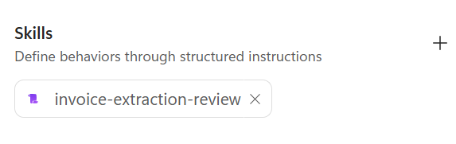 


### Step 3-2. Publish the Agent for the Workflow

Publish the agent so the Agent node can select it. See more information about [Publish](https://learn.microsoft.com/en-us/microsoft-copilot-studio/agents-experience/publication-fundamentals-publish-channels).


### Step 3-3. Build the Intake Workflow (Invoice Intake)

Create the first workflow, **Invoice Intake**, with a Copilot prompt. It calls the published agent from [Step 3-2](#step-3-2-publish-the-agent-for-the-workflow), so publish the agent first. The workflow ends with the agent call. It reads nothing from the agent and sends no email. The approval, the Finance email and the emails to the submitter belong to the second workflow in [Step 3-4](#step-3-4-build-the-approval-workflow-invoice-approval), which starts when the agent saves its row.

More information about [Workflows agent node](https://learn.microsoft.com/en-us/microsoft-copilot-studio/workflows-experience/agent-node-workflow).

1. Open the Copilot Studio **Home** page and select the same environment as in [Step 3-1](#step-3-1-create-the-agent)

   

2. Copy the following prompt to the agent builder box and click the **->** arrow button to start creating the workflow

   ```text
   Create workflow named "Invoice Intake" with automatic trigger using email arrived action. Email can have multiple attachments so we need loop but we need to process only PDF files which need to be saved to SharePoint document library. Keep workflow as simple as possible for example avoiding creating unnecessary variables

   - Get values of these Power Platform environment variables: SharePointSiteURL, SharePointDocumentLibrary and SourceFolderPath. Use variable's current value or if that is not defined then default value. If both values are missing then terminate flow run with a failed status and error message naming the missing variable(s). Look up each environment variable definition by its display name (not schema name)
   - Save PDF file to SharePoint using SharePointSiteURL, SharePointDocumentLibrary and SourceFolderPath variable values.
   - Look up the email sender using Office 365 Users connector "Get user profile" with the email's sender address as User (UPN) and Select fields set to id. Keep the id as the sender's Object ID. If the sender is not found or the lookup fails then the Object ID is empty and the run must continue. id (objectid) is used as value of SubmittedBy parameter in agent prompt
   - Invoke an existing published agent named "Invoice Processing Agent" (vs. building a new inline agent), so there's no ambiguity about whether to create a new agent or call the existing one. name node as "InvoiceProcessingAgent" with this prompt "Process invoice: [spo_saved_full_pdf_path] | Email subject: [subject_from_email]| SubmittedBy: [sender_object_id]". Remember that agent response parameter is "result" not "message". Use the default text output. This is the last step of the workflow and nothing reads the agent's response, so do not add any steps after it
   ```

3. If Copilot Studio asks for a connection for Outlook, SharePoint or Office 365 Users, sign in to create connections. In development environment use your own account and in production we should have service account

4. After the workflow is created, open it.
   
   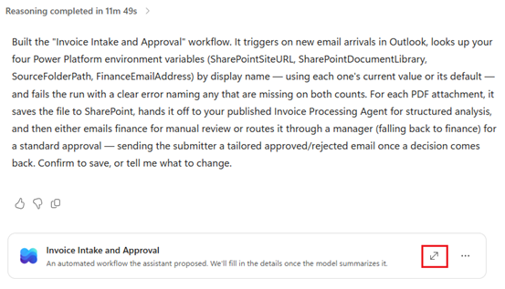

5. **IMPORTANT**! Check every row of the table below. As it is created by AI there could be something created wrongly, so test the flow carefully. If something is wrong, fix it by hand. Do not send the builder another prompt, because it can rewrite parts that were already correct.

   | # | Check | Expected | If it is wrong |
   | --- | --- | --- | --- |
   | 1 | Name and solution | The workflow is named exactly `Invoice Intake` and is part of the **Autonomous Invoice Orchestration** solution | Rename it. In [Power Apps](https://make.powerapps.com/) open **Solutions** and add the workflow to the solution |
   | 2 | Trigger | Office 365 Outlook email-arrived trigger for the invoice mailbox, with attachments included | Set the trigger and its attachment options by hand |
   | 3 | Attachment loop | A loop over the attachments. Only PDF files continue to the next steps, and other attachments are skipped | Add a condition on the file name or content type inside the loop |
   | 4 | Environment variables | The three variables `SharePointSiteURL`, `SharePointDocumentLibrary` and `SourceFolderPath` are read by display name, using the current value first and the default value second. If both are empty, the run ends as **Failed** and the message names the variable. No unnecessary variables or steps | Replace a schema-name lookup with a lookup by display name. Remove the extra steps |
   | 5 | Save file | SharePoint **Create file** uses `SharePointSiteURL` as the site, `SharePointDocumentLibrary` and `SourceFolderPath` for the folder path, and the attachment's name and content | Set the values by hand. After a test run, open the `SharePointDocumentLibrary` library and confirm that the PDF is in `/Invoices/Sources` |
   | 6 | Sender lookup | An Office 365 Users **Get user profile (V2)** step inside the loop, after the file is saved. **User (UPN)** is the email's sender address and **Select fields** is `id`. A failed or empty lookup does not stop the run, and the Object ID is then empty | Add the step and set the two values by hand. Set the step to continue the run when it fails, if Workflows offers that setting `[VERIFY]` G3 |
   | 7 | Agent node | The node is named `InvoiceProcessingAgent` and calls the existing published **Invoice Processing Agent**, not a new inline agent. Its prompt is `Process invoice:` with the saved PDF path, the email subject and `SubmittedBy:` with the Object ID from the lookup. It never carries the sender's email address. The output is the default text and is not used. The node is the last step inside the loop, and the workflow has no decision, approval or email step | Select **An existing agent** and the published agent. Delete any custom structured output and every step after the node. If the agent is not listed, publish it again as in [Step 3-2](#step-3-2-publish-the-agent-for-the-workflow) |

<br>

6. **Save** the workflow but do **NOT** publish it yet. We will publish it in item 1 of [Step 4-2](#step-4-2-test-the-workflows), after the Preview test in Step 4-1.

### Step 3-4. Build the Approval Workflow (Invoice Approval)

Create the second workflow, **Invoice Approval**, with a Copilot prompt. It starts when the agent adds a row to the **Auto Invoice Review** table and reads everything it needs from that row. It never sees the email, the PDF or the agent's reply. The table from [Step 2-2](#step-2-2-create-table) must exist and have the **Submitted By** column. **Decision** is a choice column, so the workflow compares its label.

1. Open the Copilot Studio **Home** page and select the same environment, then copy the following prompt to the agent builder box and click the **->** arrow button to start creating the workflow. The prompt reads every invoice value from the row with the Dataverse **Get row by ID** step named `Invoice`, with expressions such as `body('Invoice')?['{schemaname}_invoicenumber']`, and the prompt tells Copilot to replace `{schemaname}` with the schema name of the table. If a value is blank in a test, open the table in [Power Apps](https://make.powerapps.com/), select **Columns** and compare the **Name** of that column with the name in the expression. The Decision label comes from the `@OData.Community.Display.V1.FormattedValue` part of its expression. The trigger **Scope** is **User**, so the workflow starts only for rows that its owner owns. A row that the agent adds is owned by the account of the agent's Dataverse connection, so that account must also own this workflow.

   ```text
   Create workflow named "Invoice Approval" with automatic trigger using Microsoft Dataverse "When a row is added, modified or deleted" with Change type "Added", Table name "Auto Invoice Review" and Scope "User". Keep workflow as simple as possible for example avoiding creating unnecessary variables. Replace {schemaname} with actual table schemaname

   - First get value of this Power Platform environment variable "FinanceEmailAddress". Get variable's "current value" but if it is not defined then default value. If both values are missing then terminate flow run with a failed status and error message naming the missing variable(s). Look up each environment variable definition by its "displayname" (not schemaname)
   - Second IMPORTANT! use Dataverse "Get row by ID" action named "Invoice" to get all fields and values of the record. Use the output from this action in subsequent actions where we need field values. For example decision is choice column and we need its selected label value
   - Then you need to get submitter's email address using Office 365 Users connector's "Get user profile" action using the row's Submitted By value body('Invoice')?['{schemaname}_submittedby'], which is the user's (invoice submitter) Object ID, and Select fields set to mail. Keep mail as the submitter's email address. If SubmittedBy is empty, the user is not found or the lookup fails then the email address is empty and the run must continue
   - Add if/else to check if the Decision label body('Invoice')?['{schemaname}_decision@OData.Community.Display.V1.FormattedValue'] returned by the Dataverse table trigger equals "READY_FOR_APPROVAL". Compare the label, not the number of the choice
   - If NO (else) then send email to finance team's email address (FinanceEmailAddress) and include sender as CC with this subject: @concat('Invoice approval needed: ', body('Invoice')?['{schemaname}_invoicenumber']) and Body: <div>An invoice requires manual review.<br>Invoice number:&nbsp;@{body('Invoice')?['{schemaname}_invoicenumber']}<br>Vendor:&nbsp;@{body('Invoice')?['{schemaname}_vendorname']}<br>Decision:&nbsp;@{body('Invoice')?['{schemaname}_decision@OData.Community.Display.V1.FormattedValue']}<br>Issues:&nbsp;@{body('Invoice')?['{schemaname}_issuesfound']}<br>Summary:&nbsp;@{body('Invoice')?['{schemaname}_summary']}<br>Source PDF:&nbsp;<a href="@{body('Invoice')?['{schemaname}_sourcelink']}">Open source invoice</a><br>Review package: <a href="@{body('Invoice')?['{schemaname}_reviewlink']}">Open review package</a></div>
   - If YES then get user's manager email address for approval using Office 365 Users connector. If manager information is missing then we use FinanceEmailAddress.
   - Start standard approval named "InvoiceApproval" where approver is either manager or FinanceEmailAddress with Title: "@concat('Invoice approval needed: ', body('Invoice')?['{schemaname}_invoicenumber'])" and Details: @concat('Vendor: ', body('Invoice')?['{schemaname}_vendorname'], decodeUriComponent('%0D%0A'), ' - Total amount due: ', body('Invoice')?['{schemaname}_totalamountdue'], ' ', body('Invoice')?['{schemaname}_currency'], decodeUriComponent('%0D%0A'), ' - Invoice date: ', body('Invoice')?['{schemaname}_invoicedate'], decodeUriComponent('%0D%0A'), ' - Due date: ', body('Invoice')?['{schemaname}_duedate'], decodeUriComponent('%0D%0A'), ' - Summary: ', body('Invoice')?['{schemaname}_summary'], decodeUriComponent('%0D%0A'), ' - Source PDF: ', body('Invoice')?['{schemaname}_sourcelink'], decodeUriComponent('%0D%0A'), ' - Review package: ', body('Invoice')?['{schemaname}_reviewlink'])
   - Add If/else node with three branches having labels: "Approved", "Rejected" and "Other" (else branch).
   - If outcome value is "Approve" then get possible approval comment (there should be only one so take comment of first response) and send email to user who sent the invoice with this subject @concat('Invoice approved: ', body('Invoice')?['{schemaname}_invoicenumber']) and HTML body: <div>The invoice was approved:<br>Invoice number:&nbsp;@{body('Invoice')?['{schemaname}_invoicenumber']}<br>Vendor:&nbsp;@{body('Invoice')?['{schemaname}_vendorname']}<br>Approval Comments:&nbsp;@{outputs('InvoiceApproval')?['body/responses'][0]['comments']}<br>Source Invoice:&nbsp;<a href="@{body('Invoice')?['{schemaname}_sourcelink']}">Open source invoice</a></div><div><br></div>
   - If outcome value is "Rejected" then get possible approval comment (there should be only one so take comment of first response) and send email to user who sent the invoice with this subject @concat('Invoice rejected: ', body('Invoice')?['{schemaname}_invoicenumber']) with HTML body: <div>The invoice was rejected:<br>Invoice number:&nbsp;@{body('Invoice')?['{schemaname}_invoicenumber']}<br>Vendor:&nbsp;@{body('Invoice')?['{schemaname}_vendorname']}<br>Approval Comments:&nbsp;@{outputs('InvoiceApproval')?['body/responses'][0]['comments']}<br>Source Invoice:&nbsp;<a href="@{body('Invoice')?['{schemaname}_sourcelink']}">Open source invoice</a></div><div><br></div>
   ```

2. If Copilot Studio asks for a connection for Dataverse, Outlook, Office 365 Users or Approvals, sign in to create connections. In development environment use your own account and in production we should have service account. Use the same account for the Dataverse connection of this workflow and for the Dataverse tool of the agent, because the trigger scope is **User** and the agent's rows are owned by the account of its connection. The Dataverse connection owner needs create, read, write and delete rights on the **Callback Registration** table and read rights on **Auto Invoice Review**, or the trigger cannot be saved.

3. After the workflow is created, open it.

4. **IMPORTANT**! Check every row of the table below. As it is created by AI there could be something created wrongly, so test the flow carefully. If something is wrong, fix it by hand. Do not send the builder another prompt, because it can rewrite parts that were already correct.

   | # | Check | Expected | If it is wrong |
   | --- | --- | --- | --- |
   | 1 | Name and solution | The workflow is named exactly `Invoice Approval` and is part of the **Autonomous Invoice Orchestration** solution | Rename it. In [Power Apps](https://make.powerapps.com/) open **Solutions** and add the workflow to the solution |
   | 2 | Trigger | The Microsoft Dataverse trigger **When a row is added, modified or deleted** has **Change type** = **Added**, **Table name** = **Auto Invoice Review** and **Scope** = **User**, so that it starts only for rows that the workflow's owner owns | Set the three values by hand. A change type that includes modified rows starts an approval every time someone edits a row. If a row that the agent adds does not start the workflow, the row is owned by another account, so use the same account for the agent's Dataverse connection and for this workflow's connection `[VERIFY]` G4 |
   | 3 | Environment variable | `FinanceEmailAddress` is read by display name, using the current value first and the default value second. If both are empty, the run ends as **Failed** and the message names the variable. No other environment variable is read | Replace a schema-name lookup with a lookup by display name. Remove the extra steps |
   | 4 | Submitter lookup | An Office 365 Users **Get user profile (V2)** step with **User (UPN)** = the **Submitted By** value of the `Invoice` step and **Select fields** = `mail`. A failed or empty lookup does not stop the run, and the email address is then empty | Add the step and set the two values by hand. Set the step to continue the run when it fails, if Workflows offers that setting `[VERIFY]` G3 |
   | 5 | Decision check | An if/else that compares the Decision label, `body('Invoice')?['{schemaname}_decision@OData.Community.Display.V1.FormattedValue']`, with `READY_FOR_APPROVAL`, not with the number of the choice | Set the expression by hand. If it returns nothing, select Decision from the dynamic content of the `Invoice` step and compare it with the label. If that step returns only a number, find the number of `READY_FOR_APPROVAL` in the table's Decision choice and record the result as gate G4 |
   | 6 | Not ready for approval | The **No** branch sends an Outlook email to the `FinanceEmailAddress` value, with the submitter's email address from the lookup in **CC**. The subject names the invoice number and the body lists the invoice number, vendor, decision, issues, summary and the two links | Add the Outlook **Send an email** action, set the CC to the submitter's email address and add the missing values |
   | 7 | Approval | The **Yes** branch gets the manager of the row's Submitted By (Office 365 Users **Get manager (V2)**) and starts a standard approval named `InvoiceApproval` (**Approve/Reject - First to respond**) assigned to the manager's email address. When the submitter has no manager, or the lookup returns nothing or fails, it is assigned to the `FinanceEmailAddress` value. The title names the invoice number and the details list the vendor, total, currency, invoice date, due date, summary and the two links | Set the manager lookup, the fallback, the assignment, the title and the details by hand. The lookup fails for a submitter without a manager or with an empty Submitted By, so a failed lookup must not stop the run, and the fallback must still assign the approval |
   | 8 | Outcome branches | An if/else after the approval with three branches labelled **Approved**, **Rejected** and **Other**. **Approved** tests the outcome `Approve`, **Rejected** tests the outcome `Reject` and **Other** is the else branch with no action | The approval outcome values are `Approve` and `Reject`. If the **Rejected** test uses another text, set it to `Reject`, or a rejection ends silently in **Other** |
   | 9 | Result emails | **Approved** and **Rejected** each read the comment of the first response of `InvoiceApproval`, then send an HTML email to the submitter's email address from the lookup, with the subject `Invoice approved: ` or `Invoice rejected: ` and the invoice number. Each email lists the invoice number, vendor, the approver's comment and the two links | Set the recipient to the submitter's email address, correct the subject and add the missing comment or links |
   | 10 | Row and values | A Dataverse **Get row by ID** step named `Invoice` reads the added row with all its columns. Every invoice value is read from that step with an expression such as `body('Invoice')?['{schemaname}_invoicenumber']`. No value reads an action named `InvoiceProcessingAgent`, because this workflow has no such action. The approval details contain no blank or error value | Add the step, then replace the expression by hand, or select the column from the dynamic content of the `Invoice` step. A misspelled column name does not fail the run, it gives a blank value, so a blank value in the test emails means the name is wrong. Compare it with the **Name** of the column in the table's **Columns** page in Power Apps. Add a test row by hand as in [Step 4-2](#step-4-2-test-the-workflows) to see every value filled |

5. If everything seems to be correct and you think you are ready to start testing, then Publish this workflow. Do **not** publish **Invoice Intake** yet, because it is published in [Step 4-2](#step-4-2-test-the-workflows). **NOTE!** From now on, every row added to the **Auto Invoice Review** table under the account that owns this workflow starts it, including rows from Preview tests and rows that this account adds by hand.
   
   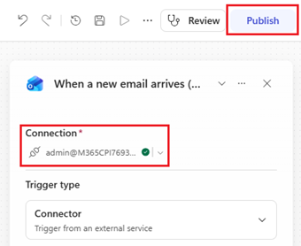
   
---

## Phase 4: Testing

### Step 4-1. Test the Agent in Preview

Use agent [Preview](https://learn.microsoft.com/en-us/microsoft-copilot-studio/agents-experience/preview-overview). 
1. Download some of the [Sample-invoices](0.Resources/Sample-invoices/README.md) to your workstation
2. In agent Preview provide following prompt or use some of the [Sample prompts](4.Sample-prompts.md#how-to-use-these-prompts) and upload the sample invoice to the chat
   
   ```text
   I want to submit this invoice for approval
   ```

   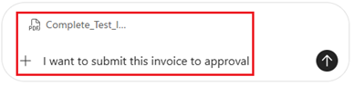 

3. Run the prompt

4. Inspect which tools were called and in what order
   
   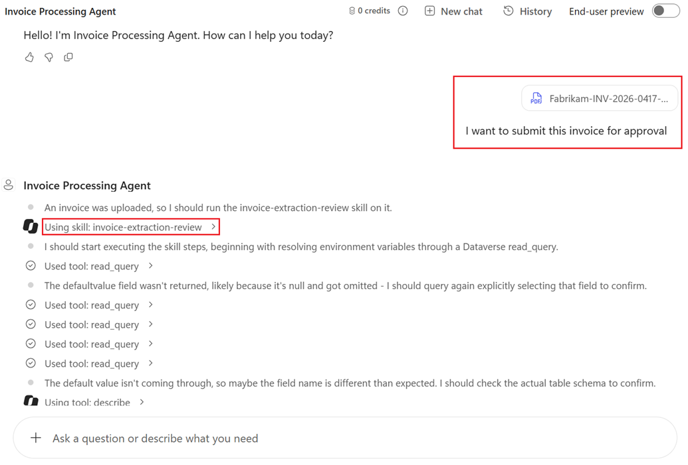

   
5. Check that PDF invoice and raw JSON review files are saved in SharePoint and Dataverse table record is created. Check also that sharing link is created for both files. The new row starts the published **Invoice Approval** workflow when the same account owns the workflow and made the agent's Dataverse connection, so check that an approval or a Finance email follows, which Step 4-2 tests in detail
   
6. Record the PDF-reading result as gate G1, then run the cases in [Capability Tests](4.Sample-prompts.md#capability-tests).

### Step 4-2. Test the Workflows

Test with a test mailbox, a test sender who has a manager, a test sender who has none and the synthetic invoices before any real mail. **Invoice Approval** is already published and the Preview test in Step 4-1 has started it, so here you publish **Invoice Intake** and test the whole chain.

1. Publish **Invoice Intake** workflow and verify that both **Invoice Intake** and **Invoice Approval** are enabled. **NOTE!** From now on the intake workflow triggers from every email sent to the invoice mailbox
   
2. Send email with some of the sample PDF invoices to email address used in the workflow trigger
   
   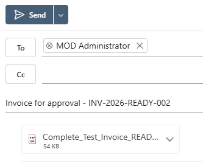
   
3. Follow the whole process workflow execution
   
   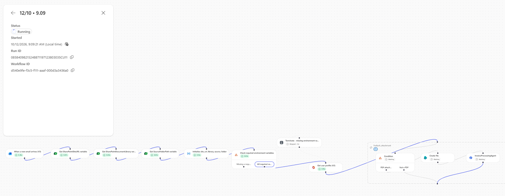 

4.  Check that files are saved in SharePoint and table record created 
   
   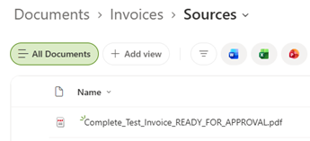

   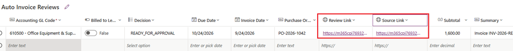 

   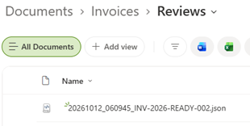 
   
5. After record is saved to table it will start **Invoice Approval** workflow. If invoice decision value is **READY_FOR_APPROVAL** then approval will be send to manager of the user submitted invoice by email. If there is no manager defined then approval should be send to email address you defined in FinanceEmailAddress environment variable
   
   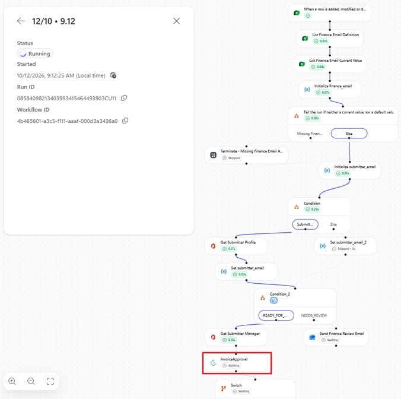
   
6. Test the approval process at least twice by approving and rejecting approval to see both emails to be sent correctly to person who submitted invoice. 
   
   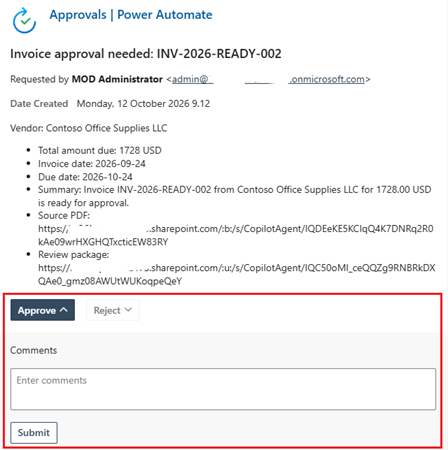 
   
7. Test also by removing the `FinanceEmailAddress` value and confirm that the run fails with a message that names it.
   
8. Then test with sample PDF invoice which is missing information and should be emailed to finance team (FinanceEmailAddress) 

   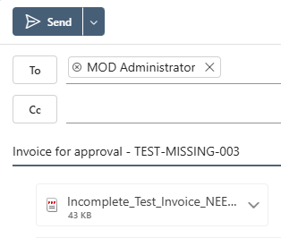  

9.  Verify that **Invoice Approval** flow didn't start the approval but sent invoice information to finance team for manual approval. Submitter should be CC'd in the email
    
    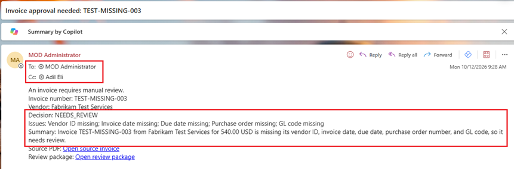 
      
10. Delete your test rows and files saved to SharePoint afterwards.
    
11. Turn off **Invoice Approval** workflow
    
12. Keep partial, failed and unknown outcomes distinct. A successful intake run does not prove that a row exists, so for a failed run, compare the saved PDFs with the rows and inspect the run history before any replay.

Record real results separately from expectations in [Sample prompts](4.Sample-prompts.md#recording-results).

### Step 4-3. Evaluate the Agent

Use [Evaluate](https://learn.microsoft.com/en-us/microsoft-copilot-studio/agents-experience/analytics-agent-evaluation-intro) with the intended agent version and a test set built from the synthetic invoices. Add explicit pass/fail checks for the written Dataverse row (including Submitted By) and the review file, in addition to any AI quality score.

---

## Phase 5: Deployment

### Step 5-1. Pilot and Promote

1. Get the pilot approval from the AP/Finance owner, the privacy owner and the release owner, with the mailbox, the sender allowlist, the Finance address, a volume cap and the pilot period named.
2. Turn on the **Invoice Approval** workflow first and then **Invoice Intake** for the dedicated pilot mailbox with synthetic invoices, then with a small set of real invoices that the owners approve. Watch the first runs, the rows, the approvals and the emails to Finance and submitters.
3. Promote the solution from Development to Test to Production. Rebind the SharePoint, Dataverse, Outlook, Office 365 Users and Approvals connections, replace the `[FILL]` values with those of the target environment, and confirm the connection owners and backup owners. Publish the agent in each environment and confirm the intake workflow selects the published agent there.
4. Record the skill version, the published agent version, the test evidence and the release approval. Close gates G7 to G9.

### Step 5-2. Monitor and Roll Back

- **Monitor:** review failed runs of both workflows, saved PDFs in `/Invoices/Sources` that have no row, the share of invoices sent to manual review, extra rows from repeated invoices, approval response times, Copilot Credit use per invoice, and a sample of extracted values against the PDFs. Wrong values that are present are not caught by the decision check.
- **Owners:** AP/Finance owns the mailbox and manual follow-up. The Power Platform engineer owns connections and failed runs. The release owner owns cost.
- **Rollback:**
  1. Turn off **Invoice Intake** first, so no new rows appear. Inspect runs in flight, then turn off **Invoice Approval** and check the approvals still pending.
  2. Remove the agent's tool exposure or unpublish the agent. Removing a skill does not revoke tool permissions.
  3. Keep the written files and rows. To process an invoice again, have the sender resubmit it, which creates another row, and delete the earlier row.
- **Maintenance:** turn off **Invoice Intake** before changing instructions, tools or the skill, and turn off **Invoice Approval** before changing the table, then republish and retest with the synthetic invoices.

Publish only after the relevant acceptance cases pass and the pilot is approved. Preserve shared connections used by enabled capabilities. Release approval is not an extra per-message approval.

---

## Summary Checklist

| Phase | Step | Status |
|---|---|---|
| Phase 0 | Environment, Copilot Credits and deployment values resolved | Not run |
| Phase 1 | SharePoint folders and permissions verified | Not run |
| Phase 2 | Dataverse solution, Auto Invoice Review table (all 18 columns, sample rows deleted) and environment variables created | Not run |
| Phase 3 | Agent created, tools, instructions and skill configured, agent published | Not run |
| Phase 3 | Workflow Invoice Intake built and saved | Not run |
| Phase 3 | Workflow Invoice Approval built and published | Not run |
| Phase 4 | Preview, workflow and Evaluate acceptance cases passed | Not run |
| Phase 5 | Approved pilot, promotion and rollback evidence recorded | Not run |

---

## Related Resources

| Resource | Link |
| --- | --- |
| Scenario Overview | [Overview](1.Overview.md) |
| Architecture | [Architecture](2.Architecture.md) |
| Sample Prompts | [Prompts](4.Sample-prompts.md) |
| Working Solution | [Working solution](5.Working-solution.md) |
| Capability and Integration Contracts | [Capability matrix](0.Resources/Capability-matrix.md) |
