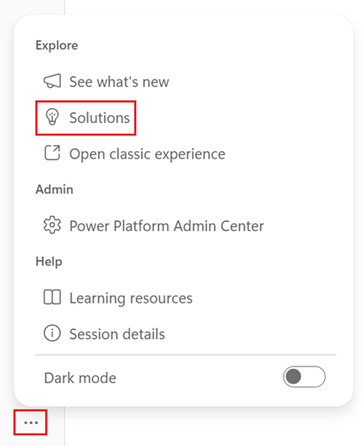

[1. Overview](1.Overview.md) > [2. Architecture](2.Architecture.md) > [3. Runbook](3.Runbook.md) > [4. Sample Prompts](4.Sample-prompts.md) > **5. Working Solution**

# Autonomous Invoice Orchestration Agent — Working Solution

## Overview

This page shows how to import the ready-made unmanaged Power Platform solution **Autonomous Invoice Orchestration** and test it. Use it instead of building the table, environment variables, agent and two workflows by hand in [Phase 2 and Phase 3 of the Runbook](3.Runbook.md#phase-2-create-dataverse-solution-table-and-environment-variables). You still prepare the environment and the SharePoint folders, create the connections, check the imported components and run the tests.

The solution is **unmanaged** and is meant for a development or test environment with the [synthetic sample invoices](0.Resources/Sample-invoices/README.md). Importing it does not close the [release gates](0.Resources/README.md#release-gates), and no tenant test evidence is included.

### What the solution contains

| Component | Name |
|---|---|
| Package | [AutonomousInvoiceOrchestration_1_0_0_0.zip](0.Resources/Working-solution/AutonomousInvoiceOrchestration_1_0_0_0.zip): solution **Autonomous Invoice Orchestration**, version 1.0.0.0, unmanaged, publisher **Contoso** with the prefix `contoso` |
| Dataverse table | **Auto Invoice Review**, with 18 columns and the native row ID |
| Environment variables | `FinanceEmailAddress`, `ReviewsFolderPath`, `SourceFolderPath`, `SharePointDocumentLibrary` and `SharePointSiteURL`. `SourceFolderPath` and `ReviewsFolderPath` have the default values `/Invoices/Sources` and `/Invoices/Reviews`, and none has a current value |
| Connection references | Eight: **SharePoint** (two), **Work IQ SharePoint MCP**, **Microsoft Dataverse**, **Office 365 Users**, **Office 365 Outlook**, **Standard approvals** and **Agents** |
| Workflows | **Invoice Approval** and **Invoice Intake**. After the import only **Invoice Approval** is turned on, and **Invoice Intake** must be published and turned on explicitly |
| Agent | **Invoice Processing Agent** with its instructions, the model Claude Sonnet 5, the tools SharePoint MCP, Dataverse MCP, `CreateFile`, `CreateSharingLink` and `GetMyProfile`, and the `invoice-extraction-review` skill |

The [Working-solution folder](0.Resources/Working-solution/README.md) describes what is and is not exported. Microsoft documents that [not every agent component is guaranteed to export](https://learn.microsoft.com/en-us/microsoft-copilot-studio/authoring-solutions-import-export), so Step 2 checks the agent, its tools and its skill.

---

## Prerequisites

| Requirement | Details |
|---|---|
| Environment | A development or test environment with Dataverse and the GitHub Copilot harness, and Copilot Credits allocated to it ([Step 0-1](3.Runbook.md#step-0-1-create-power-platform-developer-environment) and [Step 0-2](3.Runbook.md#step-0-2-configure-copilot-credits-for-the-environment) of the Runbook). The environment must not already hold the **Auto Invoice Review** table or another copy of this solution |
| Import rights | A security role that can import solutions and create their components, such as System Administrator |
| SharePoint | A site and document library with the folders `/Invoices/Sources` and `/Invoices/Reviews` ([Step 1-1](3.Runbook.md#step-1-1-create-the-sharepoint-folders-and-permissions) of the Runbook). Note the site URL and the library name |
| One account | One account that imports the solution and creates all the connections. In a development environment use your own account. It needs **Edit** rights on the SharePoint site, a mailbox for the intake trigger, access to Approvals and rights on the **Callback Registration** table. For the manager approval path, it needs a manager in the directory |
| Test invoices | The four [sample invoices](0.Resources/Sample-invoices/README.md) on your workstation |

**NOTE!** Use the same account for the import and for every connection. The importing user owns all components of the solution, and **Invoice Approval** starts only for rows that its owner owns, because its trigger scope is **User**. A row that the agent adds is owned by the account of the agent's Dataverse connection (release gate G4).

---

## Step 1. Import the Solution

1. Download [AutonomousInvoiceOrchestration_1_0_0_0.zip](0.Resources/Working-solution/AutonomousInvoiceOrchestration_1_0_0_0.zip). In GitHub, open the file and select **Download raw file**. Do not unzip it.

2. Sign in to [Copilot Studio](https://copilotstudio.preview.microsoft.com) and select the target environment. Click the three dots (**...**) in the lower left corner of the left navigation and select **Solutions**.

3. On the command bar, select **Import solution**, then **Browse**, select the zip and select **Next**.

4. Check the solution information, which shows the name **Autonomous Invoice Orchestration**, the version 1.0.0.0 and the publisher **Contoso**. Leave **Advanced settings** as they are. After the import only **Invoice Approval** is turned on, and **Invoice Intake** must be published and turned on explicitly in Step 3. Select **Next**.

5. On the **Connections** page, give each of the eight connection references an existing connection or create a new one with the account from the prerequisites. Select **Next**.

6. On the **Environment variables** page, enter the values. Three variables have no value in the package. `SourceFolderPath` and `ReviewsFolderPath` have the defaults `/Invoices/Sources` and `/Invoices/Reviews`, so the page may not ask for them. Check all five again in Step 2-1.

   | Environment variable | Value |
   |---|---|
   | `FinanceEmailAddress` | *Your own email address.* In production this is the real Finance team or service address |
   | `SharePointSiteURL` | *The URL of your SharePoint site* |
   | `SharePointDocumentLibrary` | *The name of your document library* |
   | `SourceFolderPath` | `/Invoices/Sources` |
   | `ReviewsFolderPath` | `/Invoices/Reviews` |

7. Select **Import** and wait for the success message on the **Solutions** page. If the import fails, select **Download Log File** and see [Troubleshooting](#troubleshooting).

8. Open the imported solution and select **Publish all customizations**. An unmanaged solution is imported in a draft state until you publish it.

---

## Step 2. Check the Imported Components

An import can succeed and still leave a connection, a tool or an agent reference to repair. Check each component before you test. If something is wrong, fix it by hand.

### Step 2-1. Table and environment variables

1. In the solution, open the **Auto Invoice Review** table and select **Columns**. Compare them with the [expected columns](3.Runbook.md#save-the-table-and-confirm-the-solution). All 18 columns must exist, including **Submitted By**.
2. Open each of the five environment variables. For `FinanceEmailAddress`, `SharePointSiteURL` and `SharePointDocumentLibrary` check that the **Current value** is the value that you entered, because the package has no default for them. `SourceFolderPath` and `ReviewsFolderPath` can rely on their defaults `/Invoices/Sources` and `/Invoices/Reviews`.

### Step 2-2. Agent

Open [Copilot Studio](https://copilotstudio.preview.microsoft.com), select the same environment and open **Invoice Processing Agent**.

| # | Check | Expected |
|---|---|---|
| 1 | Instructions | The instructions in the prompt of [Runbook Step 3-1](3.Runbook.md#step-3-1-create-the-agent) |
| 2 | Model | **Claude Sonnet 5**, or the model approved for your tenant |
| 3 | Tools | **Build > Tools** lists SharePoint MCP, Dataverse MCP, `CreateSharingLink`, `CreateFile` and `GetMyProfile`, and none asks for a connection. If one does, select an existing connection or create one with the account from the prerequisites |
| 4 | `CreateSharingLink` | **Link Type** is `view` and **Link Scope** is `organization`, as in item 4 of [Runbook Step 3-1](3.Runbook.md#step-3-1-create-the-agent) |
| 5 | Skill | **Build > Skills** lists `invoice-extraction-review`. If it is missing, upload it as in item 5 of [Runbook Step 3-1](3.Runbook.md#step-3-1-create-the-agent) |

When the checks pass, select **Publish**. The agent must be published before **Invoice Intake** can select it ([Runbook Step 3-2](3.Runbook.md#step-3-2-publish-the-agent-for-the-workflow)).

### Step 2-3. Workflows

After the import only **Invoice Approval** is turned on. **Invoice Intake** must be published and turned on explicitly. Check the state of both workflows right after the import.

1. Open **Invoice Approval** and compare it with the checks in [Runbook Step 3-4](3.Runbook.md#step-3-4-build-the-approval-workflow-invoice-approval). Confirm that the trigger is **Added** on **Auto Invoice Review** with scope **User**, that the **Invoice** step is a Dataverse **Get row by ID**, that its connections work and that you are its owner. It must be on, because rows added by the agent start it. If it is off, turn it on.
2. Open **Invoice Intake** and compare it with [Runbook Step 3-3](3.Runbook.md#step-3-3-build-the-intake-workflow-invoice-intake). Confirm that the trigger is **When a new email arrives** in the Inbox with attachments only, that the connections work and that the Agent node `InvoiceProcessingAgent` selects the published **Invoice Processing Agent**. If the node shows no agent, select the published agent again and save. **Keep Invoice Intake turned off** for now, because once it is turned on it triggers on every email with an attachment that arrives in the Inbox. You publish it and turn it on in Step 3.

---

## Step 3. Test the Solution

**NOTE!** Every row added to the table under the account that owns **Invoice Approval** starts that workflow. Once **Invoice Intake** is on, it triggers on every email with an attachment that arrives in its Inbox. Test only with the synthetic invoices and keep `FinanceEmailAddress` set to your own address.

| # | Test | What to do | Expected result |
|---|---|---|---|
| 1 | Agent, complete invoice | In the agent **Preview**, upload `Fabrikam-INV-2026-0417-complete.pdf` and send `I want to submit this invoice for approval` | The PDF is in `/Invoices/Sources` and the review JSON in `/Invoices/Reviews`. One row has Decision `READY_FOR_APPROVAL`, both links and your Object ID in **Submitted By**. The chat reply has a table of the extracted values and a short summary |
| 2 | Approval and outcome email | Open the approval that **Invoice Approval** sent to your manager, or to `FinanceEmailAddress` when you have no manager. Approve it. Repeat test 1 and reject it | You get the emails **Invoice approved: <invoice number>** and **Invoice rejected: <invoice number>** |
| 3 | Agent, missing information | In Preview, upload `Fabrikam-INV-2026-0418-missing-po.pdf` | The row has Decision `NEEDS_REVIEW` and Issues Found names the purchase order. No approval starts. `FinanceEmailAddress` gets an email **Invoice approval needed: <invoice number>** with you in CC |
| 4 | Intake workflow, complete invoice | Publish **Invoice Intake**, turn it on and check that both workflows are on. Send an email with `Complete_Test_Invoice_READY_FOR_APPROVAL.pdf` attached, with the [email body](4.Sample-prompts.md#how-to-use-these-prompts) from Sample prompts, to the mailbox of the intake trigger | The PDF is saved under its attachment name, the agent adds a row with the sender's Object ID in **Submitted By**, and the approval starts as in test 2 |
| 5 | Intake workflow, missing information | Email `Incomplete_Test_Invoice_NEEDS_REVIEW.pdf` the same way | The row has Decision `NEEDS_REVIEW` with the missing fields in Issues Found. No approval starts. `FinanceEmailAddress` gets an email with the sender in CC |
| 6 | Missing setting | Remove the current value of `FinanceEmailAddress`, which has no default value in the package, then add the row R1 by hand as in [Controlled Fixtures](4.Sample-prompts.md#controlled-fixtures) | The **Invoice Approval** run fails with a message that names `FinanceEmailAddress`. No approval starts and no email is sent. Restore the value afterwards |

Open the run history of both workflows and the agent's tool calls in Preview to see each step. Then run the remaining cases of the [smoke path](4.Sample-prompts.md#smoke-path) and the [acceptance cases](4.Sample-prompts.md#acceptance-cases), the [Evaluate](3.Runbook.md#step-4-3-evaluate-the-agent) test set, and record the real results as described under [Recording Results](4.Sample-prompts.md#recording-results). The steps behind tests 1 to 6 are in [Runbook Step 4-1](3.Runbook.md#step-4-1-test-the-agent-in-preview) and [Step 4-2](3.Runbook.md#step-4-2-test-the-workflows).

---

## Step 4. Clean Up

1. Turn off **Invoice Intake** first, so no new rows appear, and then **Invoice Approval**.
2. Delete the test rows from the **Auto Invoice Review** table, and the test files from `/Invoices/Sources` and `/Invoices/Reviews`.
3. Set `FinanceEmailAddress` back to the address that you want to keep.

To move toward production, follow [Runbook Step 5-1](3.Runbook.md#step-5-1-pilot-and-promote): close the release gates, rebind the connections to a service account, replace the environment variable values with those of the target environment and publish the agent in each environment.

---

## Troubleshooting

| Symptom | Likely cause and action |
|---|---|
| The import fails | Select **Download Log File** on the **Solutions** page and look for the missing component or the missing privilege. Import with an account that can create the components, such as System Administrator |
| The import shows no connection or environment variable page | The page appears only when the solution has connection references or variables that need a value. Check them in Step 2 |
| A workflow does not turn on | The importing user needs access to every connection of the workflow. Fix or share the connection, open the workflow, then save and publish it |
| The Agent node shows no agent | The agent is not published, or the reference needs repair. Publish **Invoice Processing Agent**, then select it again in the Agent node of **Invoice Intake** and save |
| A tool asks for a connection | In **Build > Tools**, select the tool and choose or create a connection with the account from the prerequisites |
| The agent adds a row but no approval starts | The row is owned by the account of the agent's Dataverse connection, and the trigger scope of **Invoice Approval** is **User**. Use the same account for the agent's Dataverse connection and for the workflow, and check that the workflow is on (G4) |
| An email or approval has blank values | A column name in an expression of **Invoice Approval** does not match the table. See check 10 in [Runbook Step 3-4](3.Runbook.md#step-3-4-build-the-approval-workflow-invoice-approval) |
| **Submitted By** is empty | `GetMyProfile` can fail for guest users (G1), and a sender who is not found in the directory has no Object ID (G3) |
| **Invoice Intake** starts for unrelated mail | It triggers on every email with an attachment that arrives in the Inbox once it is turned on. Turn it on only for the tests, use a dedicated test mailbox, and turn it off again afterwards |

---

## Official Guidance

| Topic | Link |
|---|---|
| Import a solution in Power Apps | [Import solutions in Power Platform](https://learn.microsoft.com/en-us/power-apps/maker/data-platform/import-update-export-solutions) |
| Import an agent with a solution | [Export and import agents using solutions](https://learn.microsoft.com/en-us/microsoft-copilot-studio/authoring-solutions-import-export) |
| Flow state and ownership after import | [Import a solution (Power Automate)](https://learn.microsoft.com/en-us/power-automate/import-flow-solution) |
| Connection references | [Use a connection reference in a solution](https://learn.microsoft.com/en-us/power-apps/maker/data-platform/create-connection-reference) |

---

## Related Resources

| Resource | Link |
| --- | --- |
| Scenario Overview | [Overview](1.Overview.md) |
| Architecture | [Architecture](2.Architecture.md) |
| Runbook | [Runbook](3.Runbook.md) |
| Sample Prompts | [Prompts](4.Sample-prompts.md) |
| Working solution files | [Working-solution folder](0.Resources/Working-solution/README.md) |
| Capability and Integration Contracts | [Capability matrix](0.Resources/Capability-matrix.md) |
