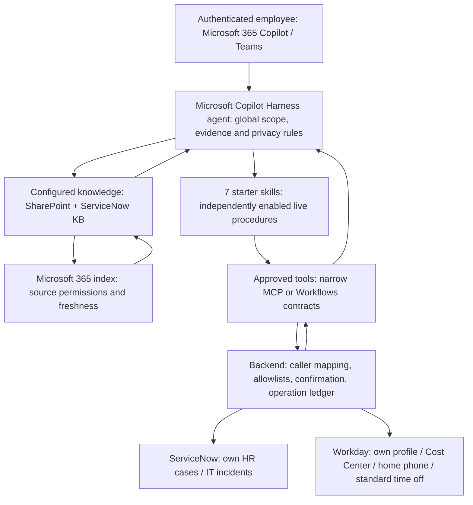

[1. Overview](1.Overview.md) > **2. Architecture** > [3. Scope and Readiness](3.Scope-and-readiness.md) > [4. Runbook](4.Runbook.md) > [5. Sample Prompts](5.Sample-prompts.md)

# Employee Self-Service Agent with Microsoft Copilot Harness - Architecture

> **Host**: Microsoft Copilot Studio, Microsoft Copilot Harness.
> **Authored**: 2026-10-28. Design and contracts only; no live integration.

## Architecture and data flow

Channels are proposed pilot surfaces supported at the host level; tenant availability, authentication, sensitive output rendering and end-user tool sign-in must still pass the runbook gates.

| Layer | Responsibility / boundary |
|---|---|
| Global instructions | HR/IT scope, grounding, privacy, no implicit writes, failure handling even when no skill loads |
| Skills | Select and execute a task-specific procedure; not a tool, identity assertion, scheduler or access-control mechanism |
| Knowledge | Retrieve approved policy/KB text and links through configured knowledge and global instructions; no separate knowledge/navigation skills |
| Live tools | Read source-system records or initiate one named action; absent until implemented and configured |
| Backend/workflow | Enforce actual caller, own-record scope, field/action allowlists, validation, exact-payload confirmation, concurrency and operation reconciliation |

A policy question follows employee -> agent -> configured knowledge -> cited answer. A personal-record question follows employee -> enabled skill -> delegated backend tool -> authorized live record -> minimal answer with source ID and retrieval time. Indexed KB content and pasted record text never establish live status or ownership.

A mutation follows authoritative metadata/current-state reads -> immutable exact preview -> trusted confirmation -> authorized vendor calls with concurrency and deduplication checks -> source status/read-back verification. Home-phone changes stage and submit one event; time-off submission starts approval routing. Incident creation writes only the confirmed severity/short description under the authenticated caller. Attachments and other follow-on actions are not enabled.

## Capability and integration contracts

Use the [capability matrix](0.Resources/Capability-matrix.md) as the seven-skill manifest and [integration contracts](0.Resources/Integration-contracts.md) as binding requirements. Tool names and paths are from the supplied definitions, **not independently verified vendor operation IDs**. Validate actual schemas and behavior in the tenant; keep every unbound capability OFF. The old 28-skill inventory is replaced, not an additional import dependency.

No connected second agent is required. The agent calls its configured tools directly; backend services enforce identity, authorization and transaction controls.

## Identity, permissions and data handling

| Identity | Required treatment |
|---|---|
| Knowledge ingestion | Admin-managed connector identity reads only approved KB scope and correct user criteria; never used for employee mutations |
| Knowledge retrieval | Signed-in employee's source permissions; test restricted KB and SharePoint items, revoked access, country scoping and index latency |
| ServiceNow actions | Delegated Microsoft Entra user context with validated claim-to-user mapping; no Basic or app-token fallback for employee operations |
| Workday actions | Validated delegated employee identity, Entra SSO and vendor domain security; no shared integration-user or maker-context substitute |
| Workflow owner | Owns configuration and deployment, not permission to impersonate every employee; effective downstream caller must be observable |

Use immutable caller mapping from the authenticated session; never trust a name, UPN or worker ID supplied by the user/model. Own-record scope is narrower than whatever an HR administrator might technically read. Restrict results to employee-visible requested fields, not internal notes or unrelated HR narrative. Resolve Workday `"me"` to its returned WID, not employee number; verify ServiceNow `gs.getUserID()` is the employee. Filter excluded identifiers, compensation and third-party contacts before model delivery. Do not index personal HR records as knowledge.

Sensitive responses remain within the current authenticated conversation. Do not put personal records, contact values or credentials into persistent memory, public test reports, screenshots or broad telemetry. Choose and validate the memory policy and transcript access/retention with the privacy owner; the baseline does not rely on memory. Use synthetic data for authoring/evaluation. A chat confirmation is not itself a durable backend authorization grant.

Disabling a capability means updating tool exposure, backend permissions and the deployed capability manifest; also cover alternate tools, active sessions, workflows and pending operations. Removing a skill alone is insufficient. Preserve shared connections still needed by other enabled skills or the original agent.

## Reliability and deployment boundaries

Knowledge answers show source versions/effective dates when available and disclose conflicting or stale evidence. Live reads report `observedAt`, coverage and pagination; an empty page is not proof of no records. No population analytics are inferred from one employee's results.

Writes require a durable operation ID and deduplication key tied to caller, operation and immutable payload. An uncertain result is reconciled, never blindly retried. Workday business-process acceptance can be pending rather than effective; polling is bounded and source state wins. Backend state/version changes invalidate confirmation and require a new preview and confirmation. No general exactly-once claim is made for underlying vendors.

The starter incident contract writes severity and short description, not a separate full-description field. Verify those persisted values and own caller; do not silently patch, attach or claim full-description fidelity. Unsupported domains, policy blocks, absent delegated sign-in or unresolved OIDC coexistence are release blockers, not reasons to use elevated credentials.

Microsoft Copilot Harness supports connectors, MCP and Workflows, but each selected integration still requires compatibility validation. Tenant cloud, model, channels, DLP, billing and supported Workday/ServiceNow execution paths remain explicit gates. There is no Microsoft Copilot Harness general-knowledge on/off switch; grounding is instructed and evaluated.

## References and navigation

See [references and validation checks](0.Resources/Official-sources.md) for support boundaries, design decisions and remaining tenant checks.

[Overview](1.Overview.md) | [Scope and Readiness](3.Scope-and-readiness.md) | [Runbook](4.Runbook.md) | [Prompts](5.Sample-prompts.md)
