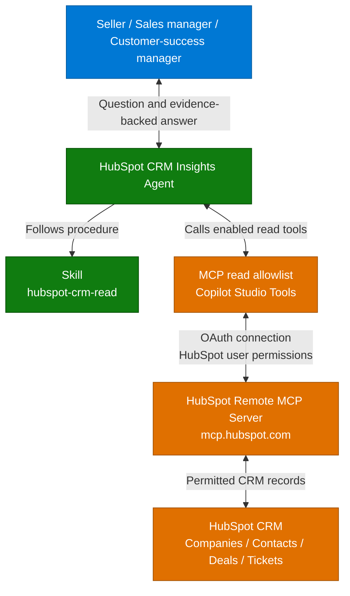

**1. Overview** > [2. Architecture](2.Architecture.md) > [3. Runbook](3.Runbook.md) > [4. Sample Prompts](4.Sample-prompts.md)

# HubSpot CRM Insights Agent with GHCP Harness — Overview

## Scenario Overview

**Scenario Type**: Sales and Customer Success (CRM)  
**Harness**: GitHub Copilot 
**Agent Type**: Read-only, tool-grounded agent with one runtime skill and an OAuth-connected MCP server 
**Primary Tools**: Microsoft Copilot Studio, HubSpot remote MCP server 
**Complexity**: Intermediate

This scenario describes a HubSpot CRM Insights Agent that lets a seller, sales manager or customer-success manager ask questions about CRM records without opening every company, contact, deal and ticket by hand. It reads HubSpot through the official remote MCP server and answers with record names and IDs. It is a **read-only** assistant: it does not create, edit, delete, send or enroll anything, and it is not a replacement for the CRM's reporting.

The standard scenario is **interactive chat** with **one runtime skill**, `hubspot-crm-read`, and a HubSpot MCP tool with only a read allowlist enabled. The supplied artifacts are documentation and a runtime skill definition, not a deployed agent. During setup, operators register an OAuth connector in a HubSpot developer account, add the MCP server to the agent, restrict its tools, and keep the agent private until the identity and data checks pass. The MCP integration of the GitHub Copilot harness is documented as a preview feature. See the [release gates](0.Resources/README.md#release-gates).

---

## Problem Statement

Customer context is spread across CRM objects and properties. Before a customer call a seller can need several tabs open, a sales manager cannot easily tell which opportunities need attention, and sales and support can describe the same customer differently when tickets and deals are not linked to the same company record.

Without clear evidence and action boundaries, an assistant can:

- Present a company name match as a relationship, or a contact as the decision maker, when the CRM does not say so.
- Report a sample page of deals as the whole pipeline, or add up amounts in different currencies.
- Infer churn risk, sentiment or an SLA breach from a stage, a priority or an age.
- Change a record, or expose the maker's CRM view to other callers, because a write tool stayed enabled or a connection was shared without testing.
- Follow an instruction hidden in a note or a description, because record text was treated as a command.

---

## Solution Summary

The **HubSpot CRM Insights Agent** connects to HubSpot's hosted remote MCP server with OAuth and uses one skill to run a repeatable query procedure: verify the account, discover the schema, resolve a company, retrieve the records and disclose the limits. The server performs the data operations. The skill carries the procedure. Neither one replaces the HubSpot user's permissions.

Agent-wide instructions define the read-only boundary and the answer format. The read-only boundary is enforced by turning off every MCP tool that is not on the allowlist, because instructions alone cannot remove a write tool. Answers separate recorded facts from analysis, state filters, currency and missing data, and treat a failed tool call as a failure and not as an empty result.

### Key Capabilities

| Capability | Description |
|---|---|
| Account and access check | `hubspot-crm-read` calls `get_user_details` to show which HubSpot user and account are connected and which objects can be read |
| Company and contact lookup | Resolves a named company with CRM search, asks when several records match, and lists associated contacts from returned data |
| Customer briefing | Combines company details, contacts, deals and, where permitted, tickets and activities. Labels each unavailable section and does not infer risk or sentiment |
| Bounded pipeline questions | Filters deals by stage, owner, amount and close date after confirming the pipeline and stage mapping. Totals need a supported aggregate or a complete bounded retrieval |
| Data exploration | Shows small real samples and the properties that describe a deal's amount, stage and close date. Never invents records for an empty account |
| Evidence and limits | Cites record names and IDs, states filters, currency and missing properties, and separates "no accessible match" from "does not exist" |
| Refusal of changes | Explains that it can inspect records and suggest a change but cannot apply it. No write tool is enabled |

### How It Works

A user asks a question in chat. The agent follows the skill, calls only the enabled HubSpot read tools through an authorized connection, and answers from the records the connected HubSpot user may see. There is no trigger, no workflow and no outbound message. A model never has to be trusted to stay read-only, because the write tools are disabled.

This is the documented flow, not a deployed integration. Identity, tool and limit details are in [Architecture](2.Architecture.md) and the [capability matrix](0.Resources/Capability-matrix.md).

---

## Business Outcomes

| Outcome | Description |
|---|---|
| Less manual preparation | Time the same briefing task before and after, and score factual correctness. A fast incorrect answer is not a saving |
| More consistent customer reviews | Measure the required fields covered and the unsupported claims per briefing. Consistency depends on record quality and associations |
| Better pipeline conversations | Check that deal lists are bounded, filtered and show stage, amount and currency evidence, and that the definition of an open or closed deal is agreed |
| Visible data-quality gaps | Track missing fields, missing associations and unclear definitions that the agent reports |
| Earlier follow-up | Track whether the user finds a recorded issue and assigns a follow-up. Do not claim revenue uplift or churn prevention |
| Reusable integration pattern | Repeat the connection and skill pattern with a second approved account, subject to preview availability and tenant policy |
| Controlled adoption | Record the connection identity, the tool allowlist, the credits per completed task and the permission tests before any sharing |

These are target outcomes and measures, not observed improvements or a guarantee of correct answers.

---

## In Scope / Out of Scope

### ✅ In Scope

- Read-only questions about HubSpot companies, contacts, deals and tickets through the official remote MCP server.
- Customer briefings and bounded pipeline and ticket summaries with record names, IDs, filters and limits stated.
- Optional totals over an explicitly filtered population, through a supported aggregate or a complete bounded retrieval.
- Optional activities and conversations where the account permits them. They are blocked when HubSpot Sensitive Data is enabled.
- Identity verification, an OAuth connection with User authentication, a tool allowlist and negative permission tests.
- Preview and Evaluate acceptance cases, with the activity trace inspected for the skill and the tools, and a private baseline before any sharing.
- Explicit handling of missing, denied, unavailable, partial, empty and failed results.

### ❌ Out of Scope

- Creating, updating, deleting or merging records, sending emails or messages, workflow enrollment, settings changes and feedback submission.
- Exact organization-wide forecasting, bulk exports and other reporting that belongs in governed CRM reporting.
- Semantic or vector search over the CRM. HubSpot documents CRM-search-based retrieval.
- Autonomous triggers, Workflows, custom backends and additional channels in the baseline.
- Per-user security trimming, unless it is shown with two different identities.
- Real sensitive customer data in a test account, and a production-ready tenant deployment.

When evidence is insufficient, the agent states what it retrieved, what it could not and why. It does not invent a record, an association, a total or a successful tool result.

---

## Target Users

| Persona | Role in This Scenario |
|---|---|
| **Account Executive** | Prepares for a customer conversation with verified people, deals and open questions |
| **Sales Manager** | Reviews the pipeline with a bounded, filtered list of deals and the evidence for stage and amount |
| **Customer-Success Manager** | Reviews account follow-up and related support information, without invented sentiment |
| **Revenue Operations** | Sees missing fields and agrees the definitions of open, won and lost deals |
| **Security Reviewer** | Approves the connected identity and the exposed tools, and runs the negative permission tests |
| **HubSpot Account Owner / Admin** | Authorizes the connector, controls the data in the account and the permissions of the connected user |
| **Delivery / Integration Engineer** | Configures the agent, the MCP server and the skill, and verifies discovery, identity and tool calls |
| **Release / Privacy / Cost Owner** | Approves the audience, the retention, the credit budget, the release evidence and the rollback |

---

## Knowledge Sources Used

| Source | Content | Category |
|---|---|---|
| HubSpot CRM through the remote MCP server | Companies, contacts, deals, tickets and permitted activities that the connected HubSpot user can read | Live CRM records |
| HubSpot schema and property metadata | Object types, property names, types and enumeration values, found with the schema and property tools | CRM metadata |
| Sample records in a developer account | Companies, contacts and, where present, deals that are approved for testing. Contents vary by account | Test data |
| Controlled test cases | The [acceptance cases](4.Sample-prompts.md#acceptance-cases), which use placeholders for names that exist in the connected account | Test design |

No knowledge source is added to the agent. All CRM facts come from successful calls to the connected HubSpot MCP server, not from earlier answers or memory. A sample record set is not a production data source, and the agent must not assume sample data exists.

Included deliverables are the four scenario documents, the capability matrix, the official-source references and one standalone runtime skill. The HubSpot connector, the Studio configuration, real CRM data, live evaluation results and deployment are not included. See the [Resources](0.Resources/README.md) for the release gates and product references, and the [Runbook](3.Runbook.md#release-gates) for the owner-assigned checks.

Runtime definitions: [Skill index](0.Resources/Skills/README.md).

---

## Related Resources

| Resource | Link |
| --- | --- |
| Architecture | [Architecture](2.Architecture.md) |
| Step-by-Step Runbook | [Runbook](3.Runbook.md) |
| Sample Prompts | [Prompts](4.Sample-prompts.md) |
| Capability and Integration Contracts | [Capability matrix](0.Resources/Capability-matrix.md) |
