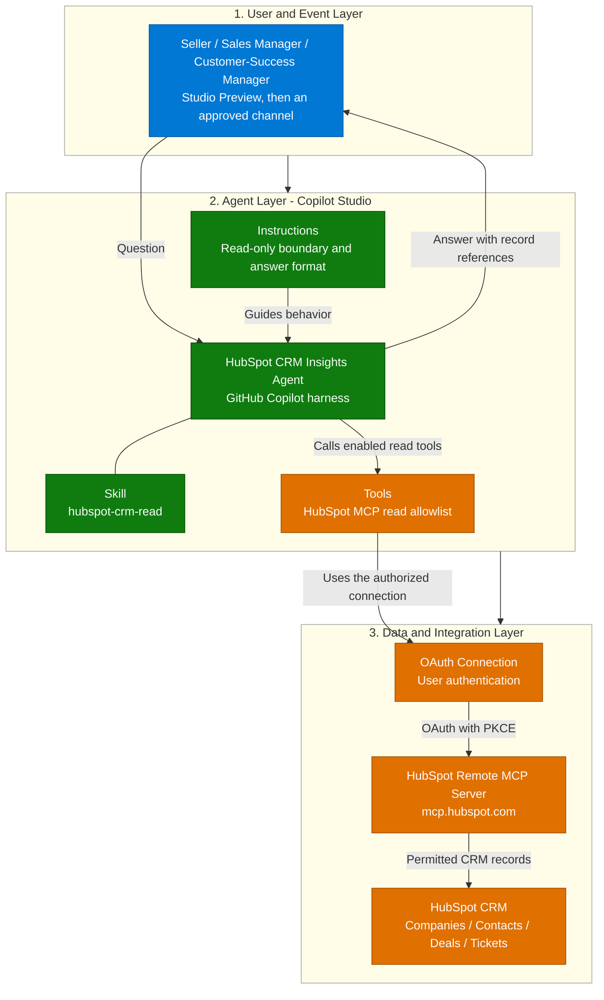
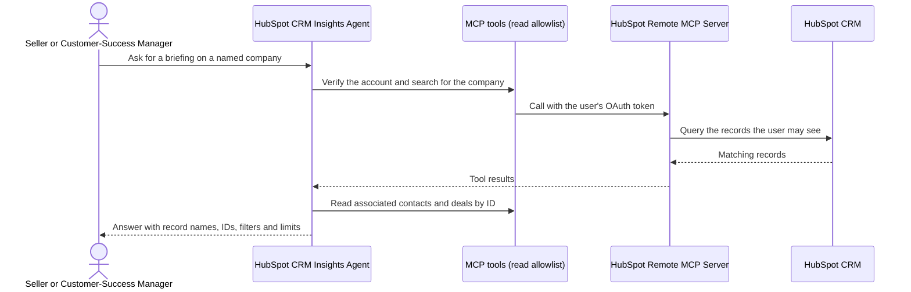
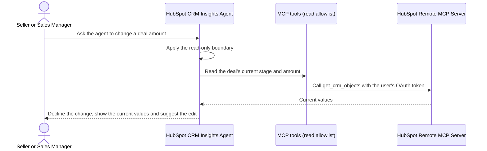
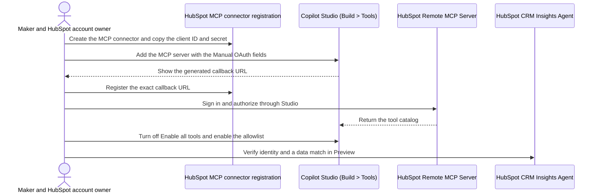

[1. Overview](1.Overview.md) > **2. Architecture** > [3. Runbook](3.Runbook.md) > [4. Sample Prompts](4.Sample-prompts.md)

# HubSpot CRM Insights Agent — Architecture

## 1. Logical Architecture

The three layers are the user in chat, the Copilot Studio GitHub Copilot agent, and HubSpot's hosted remote MCP server with its OAuth connection. The audience is sellers, sales managers and customer-success managers. Revenue operations, security and release owners use the same agent to check data quality, permissions and evidence.

One configuration holds one interactive capability. The agent follows one skill, `hubspot-crm-read`, and calls only the HubSpot MCP tools on the read allowlist. Operators configure the connector, the connection and the tool toggles in the tenant. The skill guides reasoning and formatting, and HubSpot enforces the connected user's permissions. No workflow, trigger, email or custom backend is part of this scenario.

### How It Works

The diagram summarizes three layers. Identity, tool and limit details appear below and in the [capability matrix](0.Resources/Capability-matrix.md). HubSpot hosts the MCP server, so this scenario does not wrap, proxy or cache it. The agent reads CRM facts only through successful calls to that server, and never answers a current-state question from an earlier response.

The request path is **user → agent and skill → enabled MCP tools → authorized HubSpot connection → `mcp.hubspot.com` → permitted CRM records → grounded answer with record references**. Three identities stay separate: the Microsoft maker, the HubSpot user who authorized the connection, and the OAuth connector registration. The HubSpot user's permissions decide which records a call can return.

---

## 2. Key Components

| Component | Technology | Role |
|---|---|---|
| Chat entry | Copilot Studio Preview during building, an approved channel after the release gates | Authenticated users. Channel availability and sharing scope need tenant validation |
| Agent runtime | Copilot Studio GitHub Copilot harness | Reasoning, skill procedures and tool calls, not Copilot CLI or a Copilot SDK host |
| Instructions | Agent-wide instruction text | Sources, the read-only boundary, handling of untrusted record text, reasoning limits and the response format |
| Skill | One standalone definition, `hubspot-crm-read` | The retrieval procedure for account checks, schema discovery, company resolution, record reads and limits |
| MCP tool | HubSpot remote MCP server added in **Build > Tools** | Callable read operations. Only the allowlist is enabled |
| Connection | OAuth 2.0 with the **Manual** configuration type and **User** authentication | The identity under which HubSpot receives the calls |
| MCP connector registration | HubSpot developer account, Development > MCP Connectors | The client ID and secret, the allowed redirect URL and the consent |
| CRM data | HubSpot companies, contacts, deals, tickets and permitted activities | The only source of CRM facts. HubSpot applies the connected user's permissions |
| Monitoring | Preview activity trace, Evaluate and Monitor | Operators inspect Skill and Tool nodes, tool results and credit use. No custom log or queue exists |

### Capability Design

| Capability | Component | Behavior and controls |
|---|---|---|
| Account and access check | `hubspot-crm-read` with `get_user_details` | Names the connected user and account and the readable objects. Used before any answer that depends on identity |
| Schema and property discovery | `discover_hubspot_schema`, `search_properties`, `get_properties` | Finds real object types and property names. Never guesses a property |
| Company and contact lookup | `search_crm_objects`, `get_crm_objects` | Resolves a company, asks when several records match, and lists associations only from returned data |
| Customer briefing | `hubspot-crm-read` | Facts first, then analysis. Each unavailable section is labeled. No inferred sentiment, churn risk or SLA breach |
| Bounded deal and pipeline questions | `search_crm_objects`, optional `query_crm_data` | Confirms the pipeline and stage mapping and states filters, currency and pagination. A sample is not the population |
| Read-only boundary | The tool toggles in **Build > Tools**, plus instructions | Disabled tools remove the ability to write. Instructions and the skill add a second layer |
| Failure disclosure | Skill and instructions | A failed tool call is reported as a failure. It is not an empty result |

The design uses one agent and one skill. A second agent, a separate reporting service or any write capability is not needed to answer record questions.

### Capabilities and Tool Configuration

The [matrix](0.Resources/Capability-matrix.md) records the skill, the tool allowlist, the identity table and the OAuth contract. The MCP server is added in **Build > Tools**. After sign-in, turn off **Enable all tools** and enable only the allowlisted tools, then save and reopen the configuration to confirm the state.

[Add an MCP server](https://learn.microsoft.com/en-us/microsoft-copilot-studio/agents-experience/tools-add-mcp-server) documents the form, the handshake and the tool list, and [Manage tools](https://learn.microsoft.com/en-us/microsoft-copilot-studio/agents-experience/tools-manage) documents the per-tool toggles. The server URL is the root `https://mcp.hubspot.com/`, and the form's placeholder is not copied. The callback URL that Copilot Studio generates is registered exactly in the HubSpot connector. [Resources](0.Resources/README.md#release-gates) lists the checks that must pass before the agent is shared.

The skill's description tells the agent when to use it. The agent answers general explanations that need no CRM lookup from its instructions. Formatting instructions are not independent factual validation. The release gates require answers to be compared with HubSpot records.

---

## 3. Data Flow

### Scenario A — Record Lookup and Briefing (User-Initiated)

This shows a typical record-grounded answer. If several companies match, the agent asks which one is meant. If a section is missing, denied or unavailable, the briefing says so and does not fill the gap. Follow-up questions continue the same conversation, but a new question about current facts triggers a new retrieval.

### Scenario B — Change Request Is Refused (User-Initiated)

The write-capable tools are disabled, so no write call can be made even if the model were persuaded. The agent explains the limit and suggests the change for the user to make in HubSpot. A note or description that contains an instruction is treated as record text, not as a command.

### Scenario C — Connection, Identity and Tool Discovery (Setup)

Authorization, tool discovery, identity and data correctness are four separate checks. Passing one does not prove the others. See the [troubleshooting table](0.Resources/README.md#troubleshooting-by-layer) for failures at each layer and the [Runbook](3.Runbook.md#phase-2-agent-creation-in-copilot-studio) for the steps.

---

## 4. Security & Governance Considerations

| Area | Consideration |
|---|---|
| Identity | Record the maker, the HubSpot authenticated user and the connector registration. Matching email addresses are not an identity mapping |
| Least privilege | Authorize with a HubSpot user who has only the read permissions the use case needs. HubSpot derives the connector permissions from the tools available and the permissions granted |
| Read-only enforcement | Disable every tool that is not on the allowlist. A confirmation prompt on a write tool is not the same as removing it |
| Data scope | Approved sample records or data cleared for the audience. No real sensitive customer data in a test account |
| Untrusted content | CRM text is data. A record cannot change tools, endpoints, identity or the answer format, and cannot request outbound messages |
| Secrets | The client secret lives only in an approved store and in the Copilot Studio form. It never appears in instructions, the skill, a screenshot or this repository |
| Audience | Keep the agent private until the identity, permission and answer checks pass |

### Identity, Permissions and Data Handling

**Connection identity:** the agent calls HubSpot as the user who authorized the connection. A connection owned by the maker can expose the maker's CRM view to other callers, depending on how it is configured and shared. Keep **User** authentication, and do not switch to **Maker** to avoid prompts. Per-user access and security trimming are not claimed until they are shown with two different identities.

**OAuth registration:** the HubSpot MCP connector holds the client ID, the secret and the allowed redirect URLs. It is not an app registered for another purpose, and its callback is not reused from another connector. The temporary redirect used while the connector is first created is replaced by the callback that Copilot Studio generates. Revoking access means revoking the HubSpot grant and the registration, because deleting the agent does not do either.

**CRM data handling:** the agent requests only the records and properties a question needs. It does not ask for passwords, secrets, cookies or tokens. Activities and conversations are not available when HubSpot Sensitive Data is on, and the agent labels them unavailable. Record names and IDs appear in answers, so treat the conversation history and the activity trace as customer data.

**Policy authority:** the sales operations owner approves the audience and the definitions of open, won and lost. The security reviewer approves the identity and the tool list. The HubSpot account owner controls the data and the permissions of the connected user. The release owner approves the credit budget and the rollback.

Restrict access to the agent's conversation history, the trace and any exported test results. Keep memory off and add no additional knowledge sources in the baseline. Ordinary conversation retention still needs review.

### Reliability and Deployment Boundaries

| Concern | Current limitation / operator action |
|---|---|
| Preview feature | The MCP integration of the GitHub Copilot harness is documented as preview. Re-check the form fields, the labels and the limits at rollout |
| Discovery failure | An empty tool catalog or a 404, 401 or 403 is an integration blocker. Diagnose by layer. Do not work around it with another API |
| Catalog drift | HubSpot can add tools. Re-check the enabled list after a connection or server change |
| Pagination and totals | A first page is not a population. A total needs a supported aggregate or a complete bounded retrieval |
| Rate limits | Respect retry guidance and do not loop. Heavy use is a HubSpot account matter |
| Freshness | Record changes can take time to appear in search. The agent does not promise instantaneous consistency |
| Failure | A failed tool call is not an empty result. Report it and stop |
| Citations | The platform can render raw structured citation titles for MCP results. Record this as a rendering limitation |
| Maintenance / rollback | Unshare the agent first. Removing the tool or the skill does not revoke the HubSpot grant. See [Step 4-3](3.Runbook.md#step-4-3-retire-the-agent-and-connection) |
| Cost and channels | Build, test, evaluation and runtime use Copilot Credits, even with a free HubSpot developer account. Confirm channels and sharing in [Publish channels](https://learn.microsoft.com/en-us/microsoft-copilot-studio/agents-experience/publication-fundamentals-publish-channels) |

This documentation claims neither tenant execution nor production readiness. The pattern is read-only and intended for evaluation. A wider rollout needs an identity review, a policy review, representative testing and a named owner.

---

Official guidance and remaining owner checks: [Resources](0.Resources/README.md#official-source-verification).

## Related Resources

| Resource | Link |
| --- | --- |
| Scenario Overview | [Overview](1.Overview.md) |
| Step-by-Step Runbook | [Runbook](3.Runbook.md) |
| Sample Prompts | [Prompts](4.Sample-prompts.md) |
| Capability and Integration Contracts | [Capability matrix](0.Resources/Capability-matrix.md) |
