# Runbook - ServiceNow SSO with Microsoft Entra ID and OIDC authentication configuration

Configure **SAML browser SSO to the ServiceNow application** and
**Entra ID OIDC authentication support for ServiceNow Power Platform connections**.
Start with the
[pattern overview](ServiceNow-Integration.md). Use a non-production instance for the first
pass; production changes require their own approved change and rollout plan.

OIDC configuration is a separate step in this combined runbook:
[Configure Entra ID OIDC authentication support with ServiceNow](#7-configure-entra-id-oidc-authentication-support-with-servicenow).
Browser SAML SSO does not establish a Power Platform API connection.

This runbook includes integration-user creation and pilot user provisioning. It does
not configure SSO to the ServiceNow Developer site, knowledge ingestion, MCP, or agent
delegation. The SAML setup uses Multi-Provider SSO, as described in the
[official Microsoft tutorial](https://learn.microsoft.com/en-us/entra/identity/saas-apps/servicenow-tutorial).
Navigation labels vary by ServiceNow release. The legacy ServiceNow Express procedure
is not covered here. The referenced PowerShell scripts must be obtained separately;
they are not included in this folder.

## 1. Confirm Access and Capture a Baseline

| Prerequisite | Required evidence |
| --- | --- |
| ServiceNow | Approved instance URL/release, SSO-enabled entitlement, administrator access, and availability of **Integration - Multiple Provider Single Sign-On Installer** |
| Entra ID | Correct tenant and rights to manage the enterprise application, such as Cloud Application Administrator or the applicable application-owner permissions |
| Pilot users | At least one assigned test user and one unassigned negative-test user, with known active ServiceNow counterparts |
| Identity mapping | Agreed Entra NameID source attribute and ServiceNow lookup field; values match uniquely |
| Change safety | Recorded existing identity providers/defaults, SSO properties, user mappings, app assignments, and certificate expiry dates |
| Recovery | Approved local administrator account, verified recovery route, and a second administrator session kept open |

Do not use a production administrator as the ordinary pilot account. Do not copy passwords,
assertions, private keys, session cookies, or tokens into this repository or test evidence.

Before any SSO property change, verify local access in a separate browser session.
The standard ServiceNow local-login route is
`https://<instance-name>.service-now.com/login.do`; have the instance owner confirm that
it remains usable under the actual SSO/redirect policies. Do not proceed without a tested
recovery route or an owner-approved alternative.

**Deliverable:** environment-specific baseline and a verified recovery session.

## 2. Install ServiceNow Multi Provider SSO Plugin

1. Login to ServiceNow instance using your ServiceNow admin account
   
2. Search and select **Plugins**
   
   

3. Search for `multiple provider`and select **Integration - Multiple Provider Single Sign-On Installer** plugin
   
   

4. Click **Install**
   
   

5. Select **Load demo data** and click **Install**
   
   

6. Click **Run in background**

   

## 3. Add snc_basic_auth_api_access role to admin account

1. Search and select **Users** under System Security

   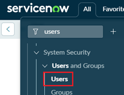

2. Search and select your system admin account
   
   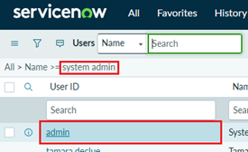

3. Click Edit to add new role
   
   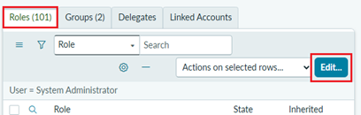

4. Search and add `snc_basic_auth_api_access` and click **Save**
   
   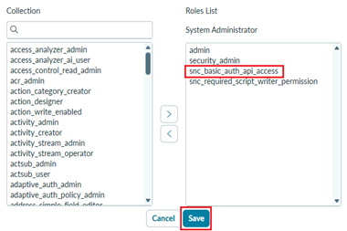

## 4. Create ServiceNow integration user

In this step we will first download package of 3 PowerShell scripts to help in the setup. Then first step is to create integration account for ServiceNow which is used to setup everything and also used as service account in Entra ID user provisioning. NOTE! This is machine (service) account which has ServiceNow **Admin** role

1. Download configuration PowerShell scripts from [ServiceNow-Integration-Setup.zip](./Resources/ServiceNow-Integration-Setup.zip) to your workstation, unzip the package and make sure that script files as not blocked and that you are allowed to run scripts
   
2. Open PowerShell 7 console
   
3. Browse to the folder where you extracted the script package
   
4. Run this command using your ServiceNow instance URL and login with admin credentials to create integration user
   
   `New-ServiceNowIntegrationUser.ps1 -ServiceNowInstance https://{instance-name}.service-now.com`
   
   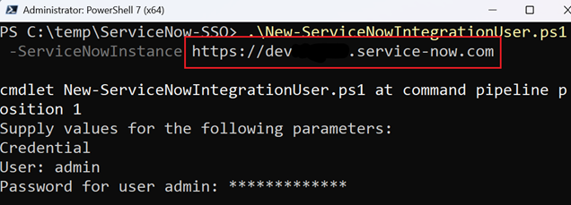

5. Account name is `int-saml`and script will generate password for the account, so copy that to some safe place

   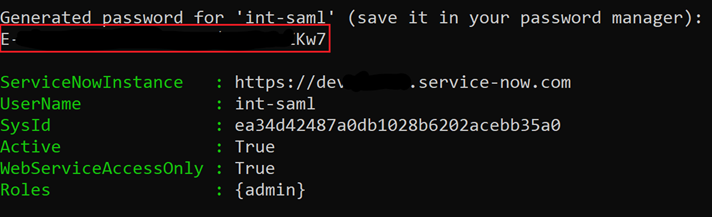
   

## 5. Enable ServiceNow Account Recovery (ACR)

1. In ServiceNow, search for `account recovery` and select **Properties** under Multi-Provider SSO > Account Recovery
   
   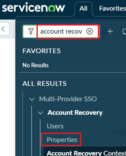

2. Click **HERE** link in step 2 to setup MFA for your admin account
   
   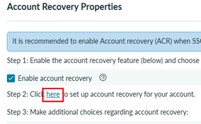
   
3. Scan the QR code 
   
   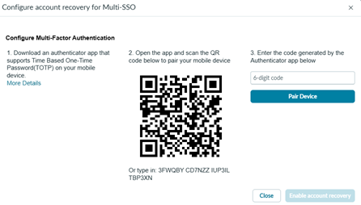

4. Enable account recovery

   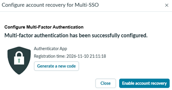

5. Select **Enable debug logging for account recovery** and click **Save**

   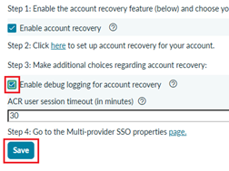

## 6. Add the ServiceNow Enterprise Application in Entra ID

Next configuration script will configure SAML SSO in Entra ID and ServiceNow side. This script requires **Az.Accounts** PowerShell module which you need to install if not available yet

1. Run this script to configure 
   
   `Configure-ServiceNowSamlSso.ps1 -ServiceNowInstance https://{instance-name}.service-now.com`
   
   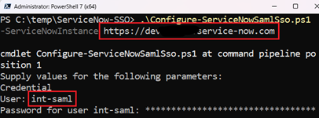

2. Login to Entra ID with account having Global Administrator permissions

   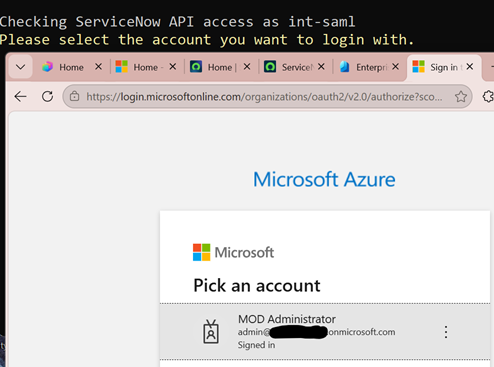

3. If script runs through successfully you should see following results

   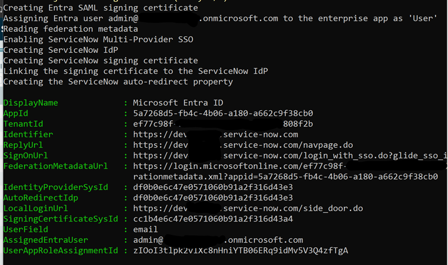

4. Open https://entra.microsoft.com select Enterprise applications > **ServiceNow**

   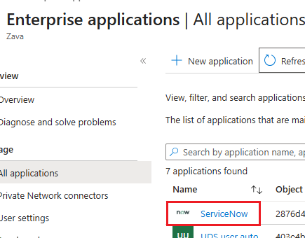

5. Select **Provisioning**
   
   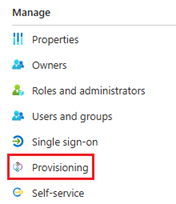

6. Select **Connect your application**

   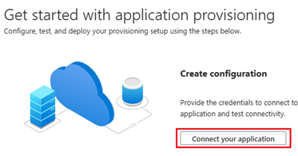

7. Provide ServiceNow instance name, your integration account username which should be `int-saml` and its password then click Test connection

   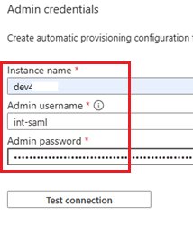

8. Click **Create**

   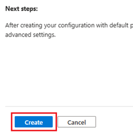

9. Click **Provision on demand**

   

10. Search and select account you want to provision to ServiceNow and click **Provision**
    
    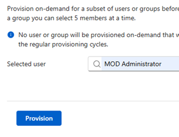

11. If successful you should see following results

    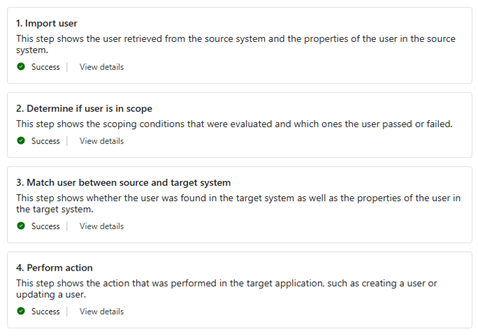

12. Move to ServiceNow > Users and search for provisioned user

    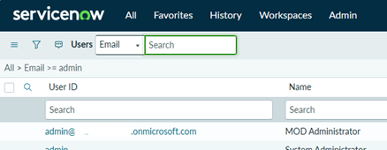

13. Select the user and if you want this to have admin permissions then add Admin role

## 7. Configure Entra ID OIDC authentication support with ServiceNow

Use this step to configure OIDC authentication for ServiceNow Power Platform connections,
independently of browser SAML SSO. Obtain an approved copy of
`Configure-ServiceNowOIDC.ps1` and install the **Az.Accounts** PowerShell module before
running it. Check existing OIDC provider dependencies, including Knowledge connector
configuration, before making changes.

1. Run `Configure-ServiceNowOIDC.ps1` script defining **DisplayName** which used as name of the registered Entra ID application and name of the OAuth configuration in ServiceNow. Another required parameter is **ServiceNowInstance**

   Script will prompt **Credentials**, so provide username and password of you integration account or other account having ServiceNow admin role

   `Configure-ServiceNowOIDC.ps1 -DisplayName <APPLICATION-NAME> -ServiceNowInstance https://{instance-name}.service-now.com`

   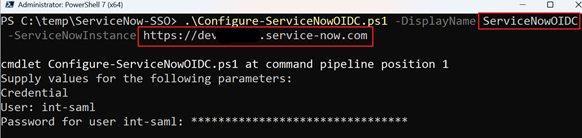

2. After successful run copy the **AppId** value (GUID). This is the Resource URI needed in Power Platform connector connection

   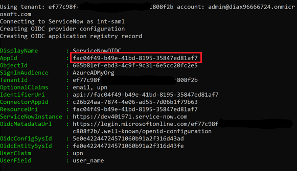

3. Create ServiceNow Power Platform connection for example in agent and configure connection like below
   
   - Authentication Type: Microsoft Entra ID User Login
   - Resource URI: *AppId copied in previous step*
   - Instance Name: *Your ServiceNow instance name*

      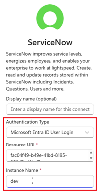

4. Validate an approved read through the actual consuming agent, app, or workflow.
   Confirm the effective ServiceNow user and verify that restricted data remains denied.
   A maker-owned connection must not be assumed to run as each end user.

**Deliverable:** a separately validated OIDC connection using **Microsoft Entra ID User
Login**. This step does not configure certificate-based application authentication,
business-record actions, or Knowledge connector ingestion.

## 8. Validate End-to-End Sign-In and Access Boundaries

Use fresh private browser sessions so that an existing local or federated session cannot
mask a configuration failure. Capture sanitized timestamps and correlation/error IDs,
not full SAML assertions.

| Test | Procedure | Pass condition |
| --- | --- | --- |
| SP-initiated sign-in | Open the provider-specific ServiceNow URL as an assigned user and complete Entra authentication | Correct instance opens as the intended source user, not the retained administrator |
| My Apps entry | Open the ServiceNow tile using the configured Sign on URL | Lands in the same intended instance/account |
| Assignment denial | Attempt the same provider path with an ordinary unassigned test user | Entra denies access to this application; no fallback through another identity is counted as a pass |
| Missing source mapping | Use an approved test identity with no matching source account and no JIT import | No unintended account is created or substituted; failure is explicit |
| Source authorization | With the pilot identity, attempt an owner-selected restricted record/action | Source permissions still deny it; no roles are added to make the test pass |
| Session and logout | Sign out and repeat the entry path; inspect ServiceNow and Entra session behavior | Observed behavior is recorded, including any remaining Entra session; local logout is not claimed to revoke all tokens |
| Recovery | Verify the separate local administrator route after activation | Administrator can still access configuration without depending on the new provider |
| Conditional Access | Exercise the pilot under applicable tenant policies | Required challenges and denials are honored; no exclusions added to bypass failure |

If a test fails, stop rollout and diagnose the relevant boundary. A successful provider
test or visible My Apps tile is not sufficient end-to-end evidence.

**Deliverable:** recorded pass/fail results, unresolved limitations, and owner acceptance.

## 9. Troubleshoot Without Broadening Access

| Symptom | Check | Safe response |
| --- | --- | --- |
| App assignment denial | Tenant, application, **Assignment required?**, and pilot membership | Correct only the approved assignment; do not allow every user |
| User not found or wrong account | Emitted NameID, configured User Field, active source record, duplicates | Correct the agreed mapping; do not enable blanket user import |
| Audience/recipient mismatch | SP Entity ID, ACS, host, trailing slash, and provider selection | Align exact values with source configuration |
| Invalid signature or expired certificate | Actual signing certificate and provider association | Restore trusted configuration or perform an approved certificate rollover |
| Redirect loop or wrong provider | Default provider, source user/provider association where applicable, and login URL sys_id | Use the explicit pilot provider URL; preserve local recovery |
| Test Connection fails | Authentication result, mappings, certificate, instance time, and sanitized logs | Fix the cause; do not disable mandatory test validation |
| SSO works but API/connector fails | API connection authentication and effective source permissions | Diagnose that separate integration; SAML success is not an API access token |

Do not grant `admin` or broad source roles to a pilot user as a troubleshooting shortcut.
Do not switch to a maker/service account to disguise a user-access failure.

## 10. Rollback, Rollout, and Handover

1. On a failed pilot, use the retained local administrator session. Restore changed
   properties, provider/default settings, and user mappings from the baseline. Deactivate
   only the newly introduced provider if appropriate; do not disable existing providers.
2. Remove or disable the new Entra pilot application/assignments only after confirming
   which other users or integrations depend on it. Restore existing application values
   instead if the pilot reused an app.
3. Recheck the previously working sign-in and local recovery routes. Account for existing
   sessions separately: assignment removal or provider deactivation does not prove that
   every active session has ended.
4. After successful pilot acceptance, obtain approval for any default-provider or
   automatic-redirection change and broader assignment. Repeat boundary tests after that
   change; local login and other providers are separate access paths to govern.
5. Assign owners for certificate expiry notifications and rollover, source user lifecycle,
   sign-in failures, and refresh/clone recovery. Test renewal before expiry; revalidate
   instance-specific endpoints and trust after an instance refresh or replacement.
6. Store the environment/app/provider identifiers, mapping rule, certificate thumbprint
   and expiry, acceptance results, rollback baseline, and support route in the approved
   operational location. Exclude credentials and raw authentication payloads.

**Exit condition:** accepted browser SSO and a separately validated Power Platform OIDC
connection, with recoverable administration and named operations owners. Browser
sign-in tests do not establish connector acceptance. No business-record mutation or
agent capability is implied by this exit condition.

## Official References

- [Configure ServiceNow SSO with Microsoft Entra ID](https://learn.microsoft.com/en-us/entra/identity/saas-apps/servicenow-tutorial)
- [ServiceNow Developer Program](https://developer.servicenow.com/)
- [Manage application user and group assignments](https://learn.microsoft.com/en-us/entra/identity/enterprise-apps/assign-user-or-group-access-portal)
- [ServiceNow automatic user provisioning](https://learn.microsoft.com/en-us/entra/identity/saas-apps/servicenow-provisioning-tutorial)
- [Manage certificates for federated SSO](https://learn.microsoft.com/en-us/entra/identity/enterprise-apps/tutorial-manage-certificates-for-federated-single-sign-on)

Documentation reviewed on **4 November 2026**. These are manual setup instructions, not
evidence that a tenant has been configured or tested.
